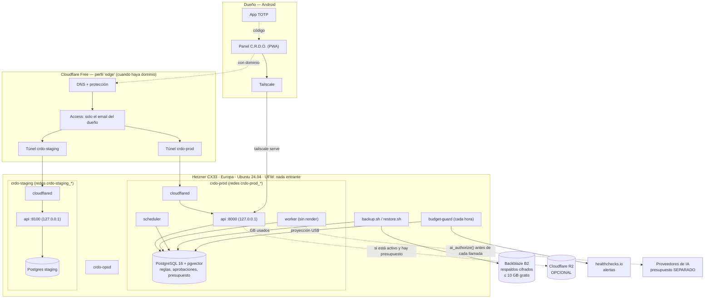
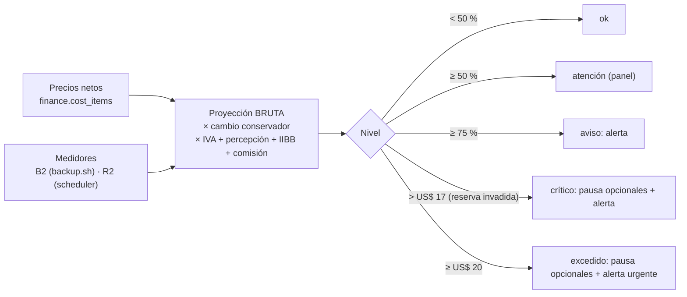

# C.R.D.O. — Etapa 1: Infraestructura central en la nube

> **Versión 3 — actualización presupuestaria oficial.**
>
> **Estado: DISEÑO. No hay nada instalado, contratado ni conectado. Instalación y gastos sin autorizar.**
>
> - Tope oficial de infraestructura: **US$ 20/mes todo incluido** (servicios, almacenamiento, respaldos,
>   dominio prorrateado, impuestos y comisiones). La IA tiene un presupuesto **separado**.
> - Las pruebas corrieron solo en el contenedor temporal de diseño (§E.1).
> - Historial: v1 diseño inicial · v2 revisión técnica ([`CAMBIOS-v2.md`](CAMBIOS-v2.md)) · v3 presupuesto
>   ([`CAMBIOS-v3.md`](CAMBIOS-v3.md)).
>
> Fecha: 7 de noviembre de 2026.

## Índice

- [Decisiones del dueño (v3)](#decisiones-del-dueño-v3)
- [A. Arquitectura](#a-arquitectura)
- [B. Presupuesto mensual detallado](#b-presupuesto-mensual-detallado)
- [C. Servicios indispensables y opcionales](#c-servicios-indispensables-y-opcionales)
- [D. Plan de instalación](#d-plan-de-instalación)
- [E. Verificaciones y pruebas](#e-verificaciones-y-pruebas)
- [F. Archivos de configuración](#f-archivos-de-configuración)
- [G. Riesgos, crecimiento y requisitos de la Etapa 2](#g-riesgos-crecimiento-y-requisitos-de-la-etapa-2)
- [Decisiones pendientes](#decisiones-pendientes)

---

## Decisiones del dueño (v3)

| # | Decisión | Cómo queda en el diseño |
|---|---|---|
| 1 | Tope absoluto US$ 20/mes | Impuesto **en la base de datos**: ni el dueño puede fijar un tope de infraestructura mayor a 20 (CHECK + función) |
| 2 | Hetzner CX33 europeo (4 vCPU / 8 GB) | Servidor por defecto. **Regla de respaldo:** si el precio final verificado lo pone por encima del tope operativo, se usa CX23 (§B.5) |
| 3 | Europa | Falkenstein, Núremberg o Helsinki, según disponibilidad |
| 4 | Ubuntu 24.04, Docker, FastAPI, PostgreSQL 16 + pgvector | Sin cambios |
| 5 | Cloudflare gratis para DNS, protección y acceso al panel | Preparado como perfil `edge`. **Requiere un dominio** (ver decisión pendiente P1); mientras tanto, panel por Tailscale |
| 6 | R2 y B2 solo cuando hagan falta, dentro de la cuota gratis | B2 se usa desde el inicio **solo para respaldos** (indispensable, < 10 GB). R2 se activa con el primer archivo de trabajo |
| 7 | Dominio opcional, sin comprar | Partida `domain` inactiva. Activarla pasa por el control presupuestario |
| 8 | Staging aislado en el mismo servidor | Proyecto, redes, base, secretos y túnel propios, con topes de recursos |
| 9 | Repositorio privado independiente | Script de exportación probado (§D, paso 3) |
| 10 | Panel compatible con Android | PWA + Tailscale hoy; + Cloudflare Access con dominio |
| — | IA fuera de los US$ 20 | Presupuesto `ai` independiente con su propio tope, autorización por llamada y crédito prepago en Anthropic |

---

## A. Arquitectura

### A.1 Diagrama

### A.2 Qué se mantiene de la v2

Todo lo aprobado en la revisión técnica sigue igual (detalle en `CAMBIOS-v2.md`):
- Aprobaciones ligadas al hash, con vencimiento, TOTP de un solo uso y consumo único.
- Cola con leases, token de exclusión, idempotencia y `needs_review`.
- El VPS no renderiza.
- Administración desde Android con `crdo-opsd`.
- Independencia de proveedor de IA.
- Respaldos cifrados y verificados.

### A.3 Qué cambia en la v3

| Área | v2 | v3 |
|---|---|---|
| Servidor | CX23 | **CX33** (CX23 como respaldo si el precio no entra) |
| Panel | Solo Tailscale | Tailscale + **Cloudflare Tunnel/Access** (perfil `edge`, un túnel por entorno) |
| Staging | A pedido | **Encendido permanente**, con topes que caben en 8 GB |
| Presupuesto | Tabla en el documento | **Control en la base**: tope inviolable, reserva, alertas, guardián, rechazo de opcionales |
| IA | Presupuesto por departamento | Categoría **`ai` independiente**; bloqueada hasta que fijes su tope |

### A.4 Control presupuestario

| Regla | Mecanismo | Probado |
|---|---|---|
| Tope ≤ US$ 20, inviolable | `CHECK` en `finance.budget_policy` y validación en la función del dueño | ✅ |
| Reserva 15 % (tope operativo US$ 17) | `reserve_pct` entre 10 y 50 | ✅ |
| Activar un opcional que superaría la reserva | `finance.set_cost_item` lo **rechaza** y revierte | ✅ (dominio en el peor escenario) |
| Un indispensable sube de precio | Se registra (es la realidad), alerta `accepted_over_budget` y el dueño decide (p. ej. CX23) | ✅ |
| Riesgo detectado | `budget-guard` cada hora: pausa opcionales (escrituras en R2), alerta y audita | ✅ con el script real |
| Reanudar | Solo el dueño, con TOTP, y solo si ya no hay riesgo | ✅ |
| La app no puede manipular el control | Sin escritura en política, impuestos, partidas ni medidores; el consumo es append-only y no admite montos negativos | ✅ |
| IA separada | El gasto de IA no consume la infraestructura; `ai_authorize()` bloquea si se pasaría de su tope operativo | ✅ |

**Los indispensables nunca se apagan solos** (servidor, IPv4, respaldos). Apagar el servidor para ahorrar
destruiría la empresa: ante ese riesgo se avisa y decide el dueño. El servidor tampoco guarda tokens de escritura
de Hetzner ni de Cloudflare: lo que exige tocar la cuenta del proveedor queda como acción del dueño.

---

## B. Presupuesto mensual detallado

### B.1 Supuestos (todos a verificar antes de contratar)

| Supuesto | Valor usado | Fuente / nota |
|---|---|---|
| Precio CX33 (Alemania/Finlandia), neto | **€ 8,49/mes** | Tras el ajuste del 15/06/2026, según fuentes secundarias. **Verificar en la consola de Hetzner** |
| IPv4 primaria, neto | **€ 0,50/mes** | Las fuentes no coinciden en si está incluida; se cuenta aparte por prudencia |
| Tipo de cambio | **1 € = US$ 1,20** | Conservador, a propósito por encima del cambio habitual |
| IVA servicios digitales del exterior (RG 4240) | **21 %** | Lo cobra el banco |
| Percepción de Ganancias (pago con tarjeta **en pesos**) | **30 %** | No aplica si se paga con dólares propios. Es un pago a cuenta, quizás recuperable, pero **se presupuesta como costo** |
| Ingresos Brutos | **2 %** | Varía por provincia: **verificar la tuya** |
| Comisiones bancarias posibles | **1 %** | Margen |
| IVA alemán facturado por Hetzner | **0 %** | A clientes fuera de la UE normalmente no se cobra. **Verificar en el checkout**; si se cobrara, ver §B.5 |
| Hetzner factura por hora con tope mensual | — | No puede cobrar más que el precio mensual por servidor (*verificar*) |

**Factor bruto en pesos** = 1 + (21 + 30 + 2 + 1)/100 = **1,54**. **Factor con dólares propios** = 1 + (21 + 2 + 1)/100 = **1,24**.

### B.2 Costos fijos

| Partida | Neto | Neto US$ | **Bruto, pago en pesos** | Bruto, dólares propios |
|---|---|---|---|---|
| Hetzner CX33 | € 8,49 | 10,19 | **15,69** | 12,63 |
| IPv4 primaria | € 0,50 | 0,60 | **0,92** | 0,74 |
| Backblaze B2 (respaldos ≤ 10 GB) | 0 | 0 | **0** | 0 |
| Tailscale Personal | 0 | 0 | **0** | 0 |
| Cloudflare Free (DNS, Tunnel, Access) | 0 | 0 | **0** | 0 |
| GitHub (repo privado, Actions dentro del cupo, GHCR) | 0 | 0 | **0** | 0 |
| healthchecks.io Hobby | 0 | 0 | **0** | 0 |
| **Total fijo** | | **10,79** | **16,61** | **13,38** |

### B.3 Reserva y margen

| | Pago en pesos | Dólares propios |
|---|---|---|
| Tope absoluto | 20,00 | 20,00 |
| Reserva (15 %) | 3,00 | 3,00 |
| **Tope operativo** | **17,00** | **17,00** |
| Total fijo | 16,61 | 13,38 |
| **Margen para opcionales sin tocar la reserva** | **0,39** | **3,62** |
| Nivel del guardián | aviso (83 %) | atención (67 %) |

> **Conclusión económica:** el CX33 **entra** en US$ 20 aun en el peor escenario, pero pagando en pesos casi no
> deja lugar para opcionales. **Recomendación: pagar con dólares propios** (tarjeta con saldo en dólares), lo que
> libera ≈ US$ 3,20/mes de margen. *Verificar con tu banco cómo se aplica en tu caso.*

### B.4 Costos variables y opcionales

| Partida | Precio neto (verificar) | Bruto/mes, pesos | Bruto/mes, US$ propios | ¿Entra sin tocar la reserva? |
|---|---|---|---|---|
| Dominio (≈ US$ 10–15/año) | US$ 15/año (prudente) | 1,93 | 1,55 | Pesos: **no** · US$ propios: sí |
| Backups automáticos Hetzner (+20 %) | € 1,70 | 3,14 | 2,53 | Pesos: no · US$ propios: sí, pero no junto con el dominio |
| R2 por encima de 10 GB | US$ 0,015/GB | +0,23 por cada 10 GB | +0,19 por cada 10 GB | Hasta ~180 GB extra con US$ propios |
| B2 por encima de 10 GB | US$ 0,006/GB | +0,09 por cada 10 GB | +0,07 por cada 10 GB | Sí; con tope del proveedor en US$ 0 (Caps & Alerts, *verificar*) |
| Tráfico por encima del incluido (20 TB en UE) | ≈ € 1/TB (*verificar*) | — | — | Irrelevante para un panel |
| **Claude API / IA** | — | **Fuera de los US$ 20** | — | Presupuesto `ai` propio |

### B.5 Escenarios y regla de decisión

| Escenario | Total fijo bruto | Decisión |
|---|---|---|
| CX33, dólares propios | US$ 13,38 | ✅ CX33 + dominio + margen |
| CX33, pesos | US$ 16,61 | ✅ CX33 sin opcionales pagos (dominio no) |
| CX33, pesos, **si Hetzner cobrara IVA alemán 19 %** | ≈ US$ 19,77 | ❌ invade la reserva → **CX23** |
| CX23 (≈ € 4–5, *verificar*), pesos | ≈ US$ 10–11 | ✅ respaldo; se sube a CX33 sin reinstalar cuando el presupuesto lo permita |

**Regla:** antes de confirmar la compra, cargar en `finance.cost_items` el precio **final** que muestre el checkout
de Hetzner y el perfil impositivo verificado. Si la proyección bruta supera US$ 17, se elige CX23.

### B.6 Alertas de consumo

| Fuente | Qué avisa | Cómo |
|---|---|---|
| `budget-guard` (cada hora) | ≥ 75 % del tope, reserva invadida, tope superado | healthchecks.io → email/Telegram; panel |
| Panel | Nivel actual, desglose por partida y medidores | Siempre visible |
| Backblaze **Caps & Alerts** | Tope diario de almacenamiento/descarga en US$ 0 | El proveedor bloquea en vez de cobrar (*verificar*) |
| Cloudflare | Notificaciones de facturación (R2) | Consola (*verificar disponibilidad en el plan gratis*) |
| Hetzner | Factura mensual | Comparación automática futura: el dueño carga el monto real y el panel lo compara con la proyección |
| Anthropic (IA) | **Crédito prepago sin recarga automática** + límite de gasto | Consola de Anthropic (*verificar*) |

---

## C. Servicios indispensables y opcionales

### C.1 Indispensables (se contratan para cerrar la Etapa 1)

| Servicio | Costo | Por qué |
|---|---|---|
| Hetzner CX33 + IPv4 (Europa) | Fijo | Servidor 24/7 |
| Backblaze B2 (≤ 10 GB) | Gratis | Respaldo fuera del proveedor: sin esto la Etapa 1 no está "respaldada" |
| Tailscale Personal | Gratis | SSH privado y panel sin dominio |
| GitHub (repo privado, CI, GHCR) | Gratis | Código propio, pruebas, imágenes |
| healthchecks.io | Gratis | Alertas de respaldo, presupuesto y caída |

### C.2 Opcionales (inactivos; cada uno pasa por el control presupuestario)

| Servicio | Disparador para activarlo | Acción automática si hay riesgo |
|---|---|---|
| Dominio propio | Querés el panel por Cloudflare sin Tailscale, o lo exige OAuth en la Etapa 2 | Aviso: no renovar (acción del dueño) |
| Cloudflare DNS/Tunnel/Access | Existe el dominio | Gratis: sin acción |
| Cloudflare R2 | Primer archivo de producción | **Pausa automática de escrituras** |
| Backups automáticos Hetzner | Hay datos de negocio y sobra margen | Aviso: desactivar (acción del dueño) |
| Subir de CX23 a CX33 (si se empezó en CX23) | RAM > 75 % sostenida y hay margen | — |

### C.3 Fuera de los US$ 20

| Servicio | Control |
|---|---|
| Claude API u otro proveedor de IA | Categoría `ai` con tope propio (hoy 0 = bloqueada), `ai_authorize()` antes de cada llamada, crédito prepago sin recarga automática |
| Workers de render (Etapa 3+) | Se presupuestarán en su propia categoría cuando existan |

---

## D. Plan de instalación

**No se ejecuta nada sin tu autorización explícita de gasto e instalación.** 🔑 = lo hacés vos.

| Paso | Qué | Gasto |
|---|---|---|
| 1 🔑 | Correo exclusivo de C.R.D.O.; 2FA con app TOTP en todas las cuentas; códigos de recuperación en papel | No |
| 2 🔑 | En Android: Tailscale, app TOTP con respaldo cifrado, gestor de contraseñas, GitHub, Termux/Termius | No |
| 3 🔑 | Crear el repo privado vacío `crdo` → exportación con `tools/export-to-private-repo.sh` → proteger `main` → CI en verde | No |
| 4 🔑 | Cuentas gratis: Tailscale (pegar `infra/tailscale/policy.hujson`), Backblaze (bucket privado, llave **sin borrado**, Caps en US$ 0), healthchecks (4 chequeos: backup, restore-test, budget, heartbeat) | No |
| 5 🔑 | Cloudflare: crear la cuenta gratis (sin dominio todavía) | No |
| 6 🔑 | **Verificación de precio:** en el checkout de Hetzner, anotar el precio final del CX33 + IPv4, con IVA si lo hubiera. Consultar en el banco el tratamiento impositivo | No |
| 7 | Cargar el precio y el perfil impositivo verificados en la proyección; aplicar la regla de §B.5 (CX33 o CX23) | No |
| 8 🔑 | **Contratar** el servidor (Europa, Ubuntu 24.04, IPv4, **sin** backups de Hetzner, firewall con SSH temporal) | **Sí: requiere autorización** |
| 9 | `bootstrap-server.sh` → quitar la regla SSH temporal | — |
| 10 | Clonar el repo, crear `prod.env` y `staging.env` (distintos), `crdo deploy x.y.z` y `crdo deploy x.y.z --env staging`, `tailscale serve` | — |
| 11 | Usuario dueño + TOTP; timers de respaldo, prueba de restauración y presupuesto; `crdo-opsd` | — |
| 12 | Pruebas de aceptación (§E.2) | — |
| 13 🔑 *(opcional)* | Dominio + Cloudflare: `infra/cloudflared/README.md`. Solo si el control presupuestario lo acepta | Sí (dominio) |

---

## E. Verificaciones y pruebas

### E.1 Ejecutadas en esta versión (contenedor temporal Ubuntu 24.04, PostgreSQL 16, pgvector 0.6.0, restic 0.16.4)

| Suite | Resultado |
|---|---|
| `tests/run-db-tests.sh`: seguridad (24), aprobaciones (23), cola (25), pgvector (8), **presupuesto (29, nuevas)**, concurrencia (3) | ✅ **112 verificaciones, 0 fallas** |
| `tests/run-backup-tests.sh`: cifrado, integridad, restauración, auditoría + **medidor B2 y `budget-guard` real (4, nuevas)** | ✅ **22 verificaciones, 0 fallas** |
| `docker compose config`: prod, staging, prod+edge, staging+edge | ✅ 4 variantes válidas. El túnel de staging solo ve redes `crdo-staging_*` |
| `bash -n` en todos los scripts | ✅ |

Cifras verificadas por las pruebas, no estimadas a mano:
- CX33 en el peor escenario: **US$ 16,61** (aviso); con dólares propios, **US$ 13,38**.
- Dominio en el peor escenario: **rechazado**.
- 300 GB en R2: **excedido**, con escrituras pausadas.
- IA: 8,00 + 0,40 autorizado y 8,00 + 1,00 bloqueado, con un tope de 10 y una reserva de 15 %.

**No verificado** (requiere servidor o cuentas): los contenedores corriendo, Tailscale, Cloudflare Tunnel/Access,
`crdo-opsd`, `crdo deploy --edge`, los timers, las Caps de B2, las alertas reales de healthchecks y el CI en GitHub.

### E.2 Pruebas de aceptación tras instalar

T01–T24 de la v2 se mantienen (disponibilidad, acceso Android, 0 puertos abiertos, TOTP, SSH, secretos, permisos,
aprobaciones, respaldos, desastre, staging aislado, despliegue con rollback, cola, render, matriz Android, CI).
Se agregan:

| ID | Prueba | Criterio |
|---|---|---|
| T25 | Comparar la primera factura real de Hetzner con la proyección | Diferencia < 5 %; si es mayor, corregir el perfil impositivo |
| T26 | Forzar el medidor de R2 por encima del tope en **staging** | `budget-guard` pausa, alerta llega al teléfono, reanudar exige TOTP |
| T27 | Intentar activar un opcional que invada la reserva desde el panel | Rechazado con explicación |
| T28 | B2 Caps & Alerts en US$ 0 | Subir más allá de la cuota gratis falla en lugar de cobrar (en un bucket de prueba) |
| T29 *(si hay dominio)* | Panel por Cloudflare desde Android sin Tailscale | Access pide login; staging y prod con túneles separados |
| T30 | Staging saturado (CPU/RAM al tope) | Producción sigue respondiendo < 3 s |

---

## F. Archivos de configuración

| Archivo | Estado v3 |
|---|---|
| `infra/compose.yml` | Topes para CX33; servicio `cloudflared` con perfil `edge` |
| `infra/compose.staging.yml` | Staging permanente con topes; túnel propio |
| `infra/.env.example` | Variables de Cloudflare por entorno; IA separada |
| `infra/db/init/04-budget.sql` | **Nuevo**: política, perfil impositivo, partidas, medidores, proyección, guardián, IA separada |
| `infra/scripts/budget-guard` + `systemd/crdo-budget-guard.{service,timer}` | **Nuevos** |
| `infra/scripts/backup.sh` | Registra los GB de B2 en el medidor |
| `infra/scripts/crdo` | Opción `--edge`; `status` muestra el presupuesto |
| `infra/scripts/bootstrap-server.sh` | CX33/Europa; activa el timer del presupuesto |
| `infra/cloudflared/README.md` | **Nuevo**: activación de Cloudflare cuando haya dominio |
| `infra/optional/edge/*` | **Eliminado** (Caddy ya no hace falta: cloudflared llega directo a la API) |
| `tests/db/50_presupuesto.sql` | **Nuevo** (29 verificaciones) |
| `tests/run-backup-tests.sh` | + 4 verificaciones de presupuesto |
| `.github/workflows/ci.yml` | Valida las 4 variantes de Compose y revisa `budget-guard` |

Sin cambios: `00-roles.sh`, `01-core.sql`, `02-memory-vector.sql`, `03-ops-functions.sql`, `restore.sh`,
`crdo-opsd`, `tailscale/policy.hujson`, `tools/export-to-private-repo.sh`.

---

## G. Riesgos, crecimiento y requisitos de la Etapa 2

### G.1 Riesgos económicos (nuevos)

| Riesgo | Mitigación |
|---|---|
| Hetzner vuelve a subir precios (ya lo hizo 3 veces en 2026, según fuentes secundarias) | Al cargar el precio nuevo, la proyección alerta; respaldo en CX23; portabilidad a otro proveedor |
| El dólar o los impuestos cambian | Cambio conservador (1,20); perfil impositivo editable con TOTP; alerta al 75 % |
| Factura en euros, presupuesto en dólares | Margen en el tipo de cambio; T25 compara con la factura real |
| R2 no tiene tope duro de gasto | Pausa automática de escrituras + alerta; uso solo dentro de la cuota |
| La percepción del 30 % puede cambiar por normativa | Se presupuesta siempre el peor caso hasta verificarlo |

### G.2 Crecer sin reconstruir

| Necesidad futura | Cómo, sin reconstruir |
|---|---|
| Más CPU/RAM | Cambiar el tamaño en Hetzner (minutos). Elegir "solo CPU y RAM" para poder volver atrás (*verificar*) |
| Más disco | Volumen adicional de Hetzner montado en `/opt/crdo/data` |
| Staging en otra máquina | El mismo `compose.yml` + `compose.staging.yml` en otro servidor |
| Base de datos aparte | Restaurar el respaldo en otro servidor y cambiar `DATABASE_URL` |
| Acceso público | `--profile edge` (ya preparado) |
| Archivos grandes | Activar R2 (interfaz S3; se puede cambiar de proveedor) |
| Render | Workers externos por la cola `render` + Tailscale (`tag:crdo-worker`) |
| Otro proveedor cloud | Docker + respaldo restic + guía de bootstrap: se reproduce en cualquier VPS Ubuntu |

### G.3 Requisitos para la Etapa 2

1. Etapa 1 cerrada (T01–T30, salvo T29 si no hay dominio).
2. **Presupuesto de IA definido por vos** (`finance.set_budget_policy('ai', …)`) y cuenta de Anthropic con
   **crédito prepago sin recarga automática**.
3. Proyecto de Google Cloud de la empresa. Verificar si OAuth exige dominio propio (lo que activaría la partida `domain`).
4. Primer departamento (sugerido: Investigación + Analítica, solo lectura) y política editorial.

---

## Decisiones pendientes

| # | Pregunta | Por qué importa | Recomendación |
|---|---|---|---|
| **P1** | Cloudflare para el panel **necesita un dominio**, pero el dominio no se compra todavía. ¿Panel por Tailscale hasta tener dominio? | Sin dominio, Cloudflare Access no se puede usar | Sí: Tailscale ahora, Cloudflare al comprar el dominio, sin reconstruir |
| **P2** | ¿Vas a pagar con **dólares propios** o con tarjeta en pesos? | Cambia el margen de US$ 0,39 a US$ 3,62 | Dólares propios |
| **P3** | ¿Mantener la reserva en 15 %? | Con pago en pesos, el dominio solo entraría bajando la reserva al 10 % | Mantener 15 % |
| P4 | ¿En qué provincia se paga? | IIBB varía (se usa 2 %) | — |
| P5 | ¿Usás otra VPN en el teléfono? (de la v2) | Tailscale ocupa la VPN de Android | Si es así, conviene adelantar el dominio y Cloudflare |

*Fin del diseño v3. Arquitectura aprobada; instalación y gastos siguen sin autorizar.*
