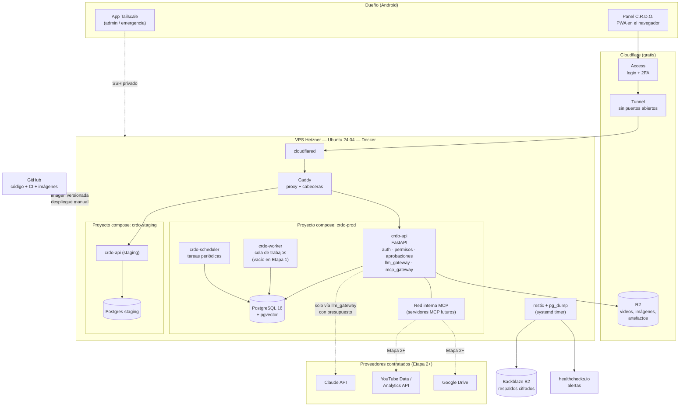
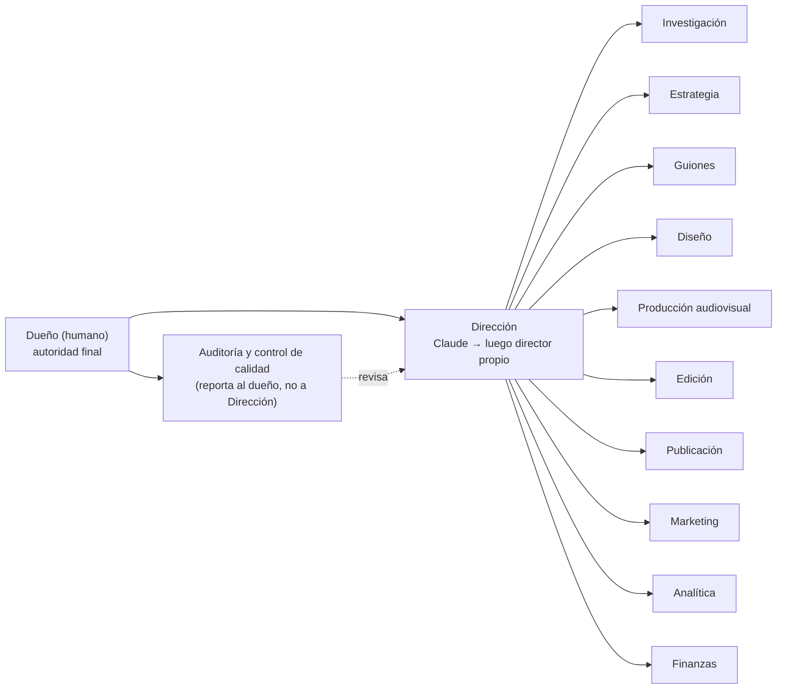
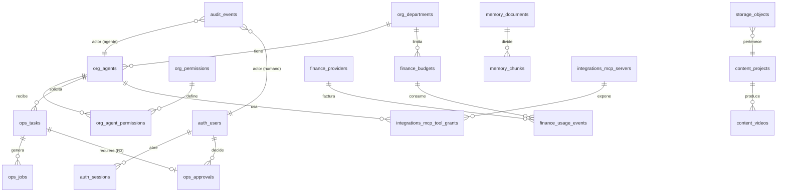

# C.R.D.O. — Etapa 1: Infraestructura central en la nube

> **Estado: DISEÑO PROPUESTO, PENDIENTE DE APROBACIÓN.**
> Nada de lo descrito aquí está instalado, contratado ni probado. No se creó ninguna cuenta,
> no se conectó ninguna cuenta personal y no se generó ningún gasto.
> Los archivos de `crdo/infra/` son **borradores de configuración**; solo se validó su sintaxis
> donde se indica explícitamente (ver §F.0).
>
> Fecha del diseño: 7 de noviembre de 2026.

---

## Índice

- [Resumen ejecutivo](#resumen-ejecutivo)
- [FASE A — Requisitos y limitaciones](#fase-a--análisis-de-requisitos-y-limitaciones)
- [FASE B — Comparación de proveedores y tecnologías](#fase-b--comparación-de-proveedores-y-tecnologías)
- [FASE C — Arquitectura completa](#fase-c--diseño-de-arquitectura-completa)
- [FASE D — Carpetas, servicios y base de datos](#fase-d--estructura-de-carpetas-servicios-y-base-de-datos)
- [FASE E — Plan de instalación](#fase-e--plan-de-instalación-y-configuración)
- [FASE F — Pruebas y criterios de aceptación](#fase-f--plan-de-pruebas-y-criterios-de-aceptación)
- [FASE G — Informe técnico final](#fase-g--informe-técnico-final)
- [Preguntas que necesito que respondas](#preguntas-que-necesito-que-respondas-antes-de-implementar)

---

## Resumen ejecutivo

| Decisión | Recomendación |
|---|---|
| Servidor | **1 VPS en Hetzner Cloud** (x86, 4 vCPU / 8 GB, plan tipo CX33), redimensionable |
| Sistema operativo | **Ubuntu Server 24.04 LTS** |
| Orquestación | **Docker + Docker Compose** (nada de Kubernetes en esta etapa) |
| Backend central | **Python 3.12 + FastAPI** (mismo lenguaje que JARVIS) |
| Base de datos | **PostgreSQL 16 + pgvector** (datos, cola de trabajos, memoria vectorial y auditoría en un solo motor) |
| Archivos pesados | **Almacenamiento S3-compatible** (Cloudflare R2) detrás de una capa de abstracción |
| Acceso desde Android | **Panel PWA** servido por el backend, publicado con **Cloudflare Tunnel + Cloudflare Access** (sin puertos abiertos) |
| Administración del servidor | **Tailscale** (SSH solo por red privada; la app de Android sirve de consola de emergencia) |
| Copias de seguridad | **restic** cifrado → Backblaze B2 (otro proveedor) + snapshots de Hetzner |
| Monitoreo | Tabla de salud propia + **healthchecks.io** (aviso si un respaldo o el servidor deja de reportar) |
| Costo fijo estimado | **≈ US$ 9–14 / mes** (a verificar, ver §B.4) + consumo variable de Claude API con tope duro |

Principio rector: **C.R.D.O. es dueña de todo** (servidor, base de datos, código en su repo, copias en su
cuenta de almacenamiento). Claude es un **proveedor contratado** al que el backend llama a través de una
puerta controlada (`llm_gateway`) que registra, limita y puede cortar el acceso. Ningún proveedor tiene
llaves de administración de la empresa.

---

## FASE A — Análisis de requisitos y limitaciones

### A.1 Requisitos funcionales (Etapa 1)

| # | Requisito | Cómo se cumple |
|---|---|---|
| RF1 | Funcionar 24/7 sin el teléfono encendido | VPS en la nube; el teléfono solo es un cliente del panel |
| RF2 | Administrable desde Android | Panel PWA instalable + Tailscale + consola web del proveedor |
| RF3 | Preparado para Claude API | Módulo `llm_gateway` con presupuesto, registro de uso y llave fuera del código |
| RF4 | Preparado para MCP | Registro de servidores MCP, red interna aislada, permisos por agente y por herramienta |
| RF5 | Preparado para 11 departamentos + dirección | Tablas `org.departments`, `org.agents`, permisos y cola de tareas listas, sin agentes construidos |
| RF6 | Memoria empresarial | PostgreSQL (hechos y decisiones) + pgvector (búsqueda semántica) + almacenamiento de objetos |
| RF7 | Integraciones futuras (YouTube, Analytics, Drive) | Tabla de integraciones y credenciales por referencia; **no se conecta nada en Etapa 1** |
| RF8 | Autorización humana para operaciones sensibles | Tabla `ops.approvals` + niveles de riesgo + confirmación con segundo factor |
| RF9 | Registro de actividades y errores | Auditoría append-only en BD + logs JSON con rotación |
| RF10 | Copias y recuperación | Respaldo diario cifrado fuera del proveedor + prueba de restauración documentada |
| RF11 | Actualizaciones controladas | Imágenes versionadas, despliegue con un comando y vuelta atrás |
| RF12 | Control de costos | Presupuestos por proveedor/departamento, alertas y corte automático |

### A.2 Requisitos no funcionales

- **Costo:** fijo bajo y predecible; lo variable (IA, almacenamiento) con tope.
- **Portabilidad:** todo en contenedores + S3 estándar + Postgres estándar → migrar de proveedor es
  “crear VPS nuevo, restaurar respaldo, cambiar DNS”. Objetivo: migración en < 2 horas.
- **Simplicidad:** un solo servidor, un solo motor de BD, sin Redis ni colas externas en esta etapa
  (la cola usa `SELECT … FOR UPDATE SKIP LOCKED` en Postgres).
- **Seguridad por defecto:** cero puertos públicos excepto los que el túnel necesita (ninguno de entrada).

### A.3 Limitaciones y supuestos

| Limitación / supuesto | Consecuencia |
|---|---|
| Administrás principalmente desde Android | Todo debe operarse por navegador o apps móviles; la terminal es opcional (Termux/JuiceSSH vía Tailscale) |
| Presupuesto bajo y sin ingresos aún | Un solo VPS; staging y producción comparten máquina pero no datos ni secretos (ver riesgo R4) |
| La suscripción de Claude (Pro/Max) **no** incluye la API | La Claude API se factura aparte por tokens en console.anthropic.com. Hay que crear una cuenta de organización con límite de gasto (Etapa 2) |
| La API de YouTube Data tiene cuota diaria (no cobro) | El diseño registra el consumo de cuota además del dinero |
| Producción de video (render) consume mucha CPU | **No** se dimensiona para render en Etapa 1. Se prevé un “worker” separado y temporal (VPS por horas o GPU alquilada) en etapas siguientes |
| Precios del cloud cambiaron varias veces en 2026 | Todo precio está marcado “verificar” y se confirma en la consola antes de contratar |

### A.4 Riesgos principales (detalle en §G.4)

1. Dependencia de un único VPS (punto único de falla) → mitigado con respaldos fuera del proveedor y procedimiento de reconstrucción automatizado.
2. Llaves de API filtradas → secretos fuera del repo, permisos 600, rotación, límites de gasto en cada proveedor.
3. Un agente que actúe fuera de lo autorizado → el backend es el único que tiene credenciales; los agentes solo piden acciones y las sensibles quedan en cola de aprobación.
4. Pérdida de acceso desde el teléfono (robo/pérdida) → 2FA con respaldo, códigos de recuperación guardados fuera del teléfono, sesiones revocables.

---

## FASE B — Comparación de proveedores y tecnologías

### B.1 Proveedores cloud comparados

Precios obtenidos de fuentes secundarias en noviembre de 2026; **hubo cambios de precio en abril y junio
de 2026 en Hetzner y Oracle, así que todos deben verificarse en la página oficial antes de contratar.**

| Criterio | **Hetzner Cloud** (recomendado) | DigitalOcean | Oracle Cloud *Always Free* | Google Cloud (Compute Engine) |
|---|---|---|---|---|
| Máquina de referencia | CX33: 4 vCPU / 8 GB / 80 GB SSD | Droplet 2 vCPU / 4 GB | Ampere A1 ARM (gratis) | e2-medium 2 vCPU / 4 GB |
| Precio mensual aprox. | **≈ €6,50** (CX23 2 vCPU/4 GB ≈ €4) — *verificar* | **≈ US$ 24** — *verificar* | **US$ 0** dentro del cupo — *verificar cupo* | ≈ US$ 25–35 según región — *verificar* |
| Transferencia incluida | 20 TB en UE (menos en EE. UU.) — *verificar* | 4 TB | 10 TB | Se cobra por GB de salida |
| Respaldos del proveedor | +20 % del precio del servidor | +20 % semanal / +30 % diario | Volúmenes y backups con cupo gratis | Snapshots por GB |
| Facilidad desde Android | Consola web usable en móvil; app no oficial | Consola web buena | Consola pesada, difícil en móvil | Consola pesada; app Cloud Console existe |
| Riesgo principal | Sin tope duro de gasto (pero precio fijo); centros de datos de menor costo en UE | Caro para lo que da | Cupo recortado en 2026 (reportan 2 OCPU/12 GB); falta de capacidad en algunas regiones; **riesgo de que borren instancias** si la cuenta cambia de estado | Facturación compleja, fácil generar gastos inesperados |
| Portabilidad | Alta (VPS + Docker) | Alta | Media (ARM: algunas imágenes no existen) | Alta si se usa solo VM |
| Veredicto | **Mejor relación precio/recursos y precio fijo predecible** | Alternativa sólida si Hetzner no acepta la cuenta | Bueno para un **entorno de pruebas gratis**, no para producción | Útil más adelante por cercanía a YouTube/Drive, no como base |

**También evaluado y descartado como base:** plataformas *serverless* (Cloud Run + Supabase, Fly.io,
Railway). Son cómodas, pero reparten los datos entre varios proveedores, cobran por uso con menos
previsibilidad y complican la regla “C.R.D.O. es dueña de su infraestructura”. Siguen siendo válidas para
piezas puntuales en el futuro (por ejemplo, un worker de render por horas).

**Recomendación:** Hetzner Cloud, plan CX33 (o CX23 si querés minimizar costo y aceptar subir de plan
más adelante; el cambio de tamaño es de minutos y sin reinstalar). Como **plan B** sin gasto: Oracle
Always Free para staging, si conseguís capacidad en tu región.

> Ubicación: Hetzner ofrece UE (Alemania/Finlandia), EE. UU. (Ashburn/Hillsboro) y Singapur. Desde
> Argentina, Ashburn tiene menor latencia, pero en EE. UU. el precio y la transferencia incluida son
> distintos. Para un panel de administración la latencia de UE (~250 ms) es aceptable. **Pregunta Q2.**

### B.2 Tecnologías seleccionadas y justificación

| Pieza | Elegido | Alternativas consideradas | Por qué |
|---|---|---|---|
| SO | Ubuntu 24.04 LTS | Debian 12, Rocky | Soporte hasta 2029 (2034 con Pro gratis personal), documentación abundante, `unattended-upgrades` |
| Contenedores | Docker Engine + Compose v2 | Podman, k3s | Estándar, portable, suficiente para 1 servidor |
| Proxy / TLS | Caddy 2 | Nginx, Traefik | Configuración mínima, HTTPS automático, cabeceras de seguridad fáciles |
| Exposición del panel | Cloudflare Tunnel + Access | Puerto 443 abierto, VPN obligatoria | Ningún puerto entrante; login con Google/email OTP antes de llegar al servidor; gratis hasta 50 usuarios (*verificar*) |
| Acceso administrativo | Tailscale | WireGuard manual, SSH público | App Android oficial, gratis en plan personal, SSH sin exponer el puerto 22 |
| Backend | FastAPI (Python 3.12) | Node/NestJS, Go | Coherente con JARVIS; SDKs oficiales de Anthropic, MCP y Google en Python; tipado con Pydantic |
| Base de datos | PostgreSQL 16 + pgvector | SQLite, MySQL, Supabase | Un solo motor para relacional, JSON, cola, vectores y auditoría; respaldo trivial |
| Cola de trabajos | Tabla `ops.jobs` en Postgres | Redis + Celery, RabbitMQ | Menos piezas; volumen de Etapa 1–3 es bajo |
| Objetos (videos, imágenes) | Cloudflare R2 (S3) | Backblaze B2, MinIO local | Sin costo de salida; 10 GB gratis (*verificar*); API S3 estándar → portable |
| Respaldos | restic → Backblaze B2 | Borg, rclone | Cifrado, deduplicado, verificable; B2 es otro proveedor (regla 3-2-1) |
| Monitoreo | `/health` + tabla `sys.health_checks` + healthchecks.io | Prometheus+Grafana, Uptime Kuma | Prometheus es excesivo para 1 VPS; healthchecks avisa por email/Telegram si algo deja de “latir” |
| Panel | PWA en HTML + JS sin framework (como Radar y JARVIS) | React, Next.js | Sin compilación, liviano en Android, instalable en pantalla de inicio |
| Secretos | Archivos `.env` root-only fuera del repo; opcional `sops + age` para versionarlos cifrados | Vault, Doppler | Vault es excesivo; sops permite reconstruir desde el repo sin exponer secretos |
| CI/CD | GitHub Actions → imagen en GHCR → `crdo deploy <versión>` manual | Watchtower, despliegue automático | Ningún cambio llega a producción sin acción humana |

### B.3 Preparación para Claude y MCP (sin conectar nada)

- **Claude API:** el backend tendrá un único punto de salida, `llm_gateway`, que:
  1. lee la llave desde el entorno (`ANTHROPIC_API_KEY`, ausente en Etapa 1);
  2. verifica el presupuesto restante del departamento y global antes de cada llamada;
  3. registra modelo, tokens de entrada/salida, costo estimado y tarea en `finance.usage_events`;
  4. corta las llamadas si se supera el tope (además del tope duro configurado en la consola de Anthropic).
- **MCP:** C.R.D.O. actuará en dos roles:
  - **Cliente MCP** (los futuros agentes usan herramientas expuestas por servidores MCP: Drive, YouTube, BD interna).
  - **Servidor MCP propio** (`crdo-mcp`) que expone *solo* operaciones del backend con permisos —
    nunca acceso directo a la BD ni a credenciales—. Así Claude (o cualquier otro modelo) se conecta a
    C.R.D.O. con transporte *Streamable HTTP* + OAuth y solo ve lo que su rol permite.
  - Los servidores MCP corren como contenedores en una red Docker interna (`crdo_mcp`), sin salida a
    Internet salvo los dominios que necesiten.
  - Tabla `integrations.mcp_servers` + `integrations.mcp_tool_grants` definen qué agente puede usar qué
    herramienta y con qué nivel de riesgo.

### B.4 Presupuesto mensual estimado

Todos los importes son **estimaciones a verificar** en la página oficial antes de contratar. Tipo de
cambio de referencia: 1 € ≈ 1,08–1,15 US$ (*verificar*). No incluye impuestos argentinos sobre servicios
digitales del exterior, que pueden sumar un porcentaje importante al pagar con tarjeta (*verificar con tu
banco*).

**Costos fijos**

| Concepto | Estimado / mes | Nota |
|---|---|---|
| VPS Hetzner CX33 (o CX23) | €6,50 (≈ €4) | *Verificar*: cambios de precio en abril y junio 2026 |
| IPv4 pública Hetzner | ≈ €0,50–0,60 | Se cobra aparte en Hetzner (*verificar*). Con Cloudflare Tunnel se podría usar solo IPv6, pero se recomienda IPv4 para simplicidad |
| Backups automáticos de Hetzner (+20 %) | ≈ €1,30 | Opcional; complementa restic, no lo reemplaza |
| Dominio propio (ej. `crdo.xyz`/`.com`) | ≈ US$ 1 (US$ 10–15/año) | Necesario para Cloudflare Tunnel con nombre propio. *Pregunta Q1* |
| **Subtotal fijo** | **≈ US$ 9–11** | |

**Servicios gratuitos usados (dentro de sus límites, a verificar)**

| Servicio | Plan gratuito | Uso |
|---|---|---|
| Cloudflare | DNS, Tunnel, Access (≤ 50 usuarios), R2 10 GB | Exposición segura del panel, almacenamiento de objetos |
| Backblaze B2 | 10 GB | Respaldos cifrados fuera de Hetzner |
| Tailscale | Plan Personal | Acceso administrativo |
| GitHub | Repos privados, Actions con minutos gratis, GHCR | Código, CI, imágenes |
| healthchecks.io | Plan Hobby (≈ 20 chequeos) | Alertas de respaldos y servidor caído |
| Let's Encrypt / Cloudflare TLS | Gratis | Certificados |

**Consumo variable (aparece desde Etapa 2)**

| Concepto | Cómo se cobra | Control |
|---|---|---|
| Claude API | Por millón de tokens, distinto por modelo (*verificar en anthropic.com/pricing*) | Tope mensual en la consola de Anthropic + tope interno por departamento |
| R2 / B2 por encima del gratis | Por GB-mes almacenado (y operaciones) | Alertas en 80 % del cupo gratis; política de ciclo de vida para borrar intermedios |
| Google Drive (si se usa) | 15 GB gratis; luego plan Google One | Preferir R2 para archivos de trabajo; Drive solo para entregables |
| YouTube Data / Analytics API | Gratis con cuota diaria (unidades) | `finance.usage_events` registra unidades consumidas |
| Worker de render (futuro) | Por hora | Fuera de Etapa 1 |

**Escenarios Etapa 1:** mínimo ≈ US$ 6–7 (CX23, sin backups Hetzner, sin dominio, usando Tailscale para
todo); recomendado ≈ US$ 9–14; con staging separado en otro VPS ≈ US$ 14–20.

---

## FASE C — Diseño de arquitectura completa

### C.1 Diagrama general



### C.2 Capas y responsabilidades

| Capa | Componente | Responsabilidad | Quién puede tocarla |
|---|---|---|---|
| Borde | Cloudflare Access + Tunnel | Autenticar antes de llegar al servidor; ocultar la IP | Dueño |
| Entrada | Caddy | Enrutar `panel.` / `staging.`, cabeceras de seguridad, límite de tamaño | Dueño (config en repo) |
| Núcleo | `crdo-api` | Única autoridad: usuarios, agentes, permisos, aprobaciones, auditoría, presupuestos, puertas a IA y MCP | Código revisado en GitHub |
| Ejecución | `crdo-worker` | Ejecuta trabajos de la cola con la identidad del agente que los pidió | Solo a través de la cola |
| Tiempo | `crdo-scheduler` | Respaldos lógicos, chequeos de salud, cierre diario de costos | Configuración |
| Datos | PostgreSQL | Fuente de verdad. Ningún agente se conecta directo | Solo `crdo-api`/`worker` con usuarios de BD de permisos mínimos |
| Objetos | R2 | Archivos grandes, referenciados por `storage.objects` | Solo backend con llave de alcance limitado a un bucket |
| Resguardo | restic → B2 | Copias cifradas fuera del proveedor | Llave solo de escritura (*append-only*) desde el VPS |

### C.3 Modelo organizacional preparado (sin agentes)



Auditoría reporta directamente al dueño para que la Dirección (incluido Claude) no pueda silenciarla.

### C.4 Niveles de riesgo y autorización

| Nivel | Ejemplos | Regla |
|---|---|---|
| **R0 — Lectura** | Leer métricas, buscar en memoria | Automático si el agente tiene el permiso |
| **R1 — Interno reversible** | Crear borrador de guion, guardar nota, encolar tarea | Automático + auditado |
| **R2 — Gasto menor dentro de presupuesto** | Llamar a Claude API, generar una imagen | Automático mientras quede presupuesto; corte al superar tope |
| **R3 — Sensible / externo** | Publicar o programar un video, cambiar título público, responder comentarios, gasto fuera de presupuesto, conectar una cuenta | **Requiere aprobación humana** en el panel, con segundo factor, con vencimiento |
| **R4 — Prohibido a agentes** | Borrar canal/videos, cambiar contraseñas o métodos de pago, modificar permisos, borrar respaldos, desactivar auditoría | Solo el dueño, manualmente, fuera del sistema de agentes |

Las acciones R3 se guardan en `ops.approvals` con el **contenido exacto** a ejecutar (hash incluido): si
el agente cambia algo después de la aprobación, el hash no coincide y la acción se rechaza.

### C.5 Entornos

| | Producción | Staging (pruebas) |
|---|---|---|
| Compose project | `crdo-prod` | `crdo-staging` |
| Base de datos | contenedor y volumen propios | contenedor y volumen propios |
| Secretos | `/opt/crdo/secrets/prod.env` | `/opt/crdo/secrets/staging.env` (llaves distintas, presupuestos ínfimos) |
| URL | `panel.<dominio>` | `staging.<dominio>` |
| Integraciones externas | Reales (desde Etapa 2, tras aprobación) | Cuentas de prueba o simuladas; **nunca** el canal real |
| Recursos | prioridad | límites de CPU/RAM más bajos |

Mientras ambos compartan VPS, staging tiene límites de memoria para no afectar producción. Si el
presupuesto lo permite, staging pasa a otro VPS (o a Oracle Always Free) sin cambios de código.

---

## FASE D — Estructura de carpetas, servicios y base de datos

### D.1 Repositorio (código, en GitHub)

```
crdo/
├── docs/
│   ├── ETAPA-1-DISENO.md        ← este documento
│   └── runbooks/                ← procedimientos (restaurar, rotar llaves, migrar) [Etapa 1, implementación]
├── infra/
│   ├── compose.yml              ← servicios base (borrador incluido)
│   ├── compose.staging.yml      ← diferencias de staging (borrador incluido)
│   ├── .env.example             ← variables sin valores reales (borrador incluido)
│   ├── caddy/Caddyfile          ← proxy (borrador incluido)
│   ├── cloudflared/config.yml   ← túnel (borrador incluido)
│   ├── db/init/                 ← esquema inicial SQL (borrador incluido)
│   ├── scripts/
│   │   ├── bootstrap-server.sh  ← endurecimiento del VPS (borrador incluido)
│   │   ├── backup.sh            ← pg_dump + restic (borrador incluido)
│   │   ├── restore.sh           ← restauración (borrador incluido)
│   │   └── crdo                 ← CLI: deploy / rollback / status (borrador incluido)
│   └── systemd/                 ← timers de respaldo (borrador incluido)
├── backend/                     ← [implementación tras aprobación]
│   ├── pyproject.toml
│   ├── Dockerfile
│   ├── crdo/
│   │   ├── main.py              ← FastAPI
│   │   ├── config.py            ← lectura de entorno, sin secretos en código
│   │   ├── db/                  ← conexión, migraciones (Alembic)
│   │   ├── auth/                ← usuarios humanos, sesiones, TOTP, tokens de agentes
│   │   ├── policy/              ← permisos, niveles de riesgo, aprobaciones
│   │   ├── audit/               ← registro append-only
│   │   ├── jobs/                ← cola y worker
│   │   ├── memory/              ← memoria empresarial y búsqueda vectorial
│   │   ├── storage/             ← abstracción S3 (R2 hoy, otro mañana)
│   │   ├── finance/             ← presupuestos y consumo
│   │   ├── gateways/
│   │   │   ├── llm_gateway.py   ← única salida hacia Claude (desactivado en Etapa 1)
│   │   │   └── mcp_gateway.py   ← registro y control de servidores MCP (desactivado)
│   │   ├── health/              ← /health, métricas del sistema
│   │   └── api/                 ← rutas REST del panel
│   └── tests/
├── panel/                       ← PWA (HTML + JS sin framework)
│   ├── index.html, app.js, styles.css, sw.js, manifest.webmanifest
├── mcp/                         ← servidores MCP propios y configuración de los de terceros (Etapa 2+)
│   └── README.md
└── agents/                      ← definiciones de agentes por departamento (vacío hasta Etapa 2)
    └── README.md
```

### D.2 Servidor (datos, en el VPS)

```
/opt/crdo/
├── app/                 ← clon del repo (solo lectura para los contenedores)
├── secrets/             ← root:root 700; prod.env, staging.env, restic.env (600)
├── data/
│   ├── prod/postgres/   ← volumen de Postgres producción
│   └── staging/postgres/
├── backups/             ← volcados locales temporales (se suben y se rotan)
├── logs/                ← logs JSON rotados por logrotate (14 días local)
└── releases/            ← registro de versiones desplegadas (para rollback)
```

### D.3 Servicios (contenedores)

| Servicio | Imagen | Red | Puertos al host | Memoria máx. (prod) |
|---|---|---|---|---|
| `cloudflared` | `cloudflare/cloudflared` (versión fija) | `edge` | ninguno | 128 MB |
| `caddy` | `caddy:2` (versión fija) | `edge`, `app` | ninguno (solo 127.0.0.1 opcional) | 128 MB |
| `api` | `ghcr.io/<org>/crdo-api:<versión>` | `app`, `data`, `mcp` | ninguno | 1 GB |
| `worker` | misma imagen, comando distinto | `data`, `mcp` | ninguno | 1 GB |
| `scheduler` | misma imagen, comando distinto | `data` | ninguno | 256 MB |
| `postgres` | `pgvector/pgvector:pg16` (versión fija) | `data` (interna) | ninguno | 2 GB |

Redes: `data` y `mcp` se crean como `internal: true` (sin salida a Internet). Solo `api`/`worker` tienen
salida, y en Etapa 2 se puede restringir por dominio con un proxy de salida.

### D.4 Base de datos

Se organiza en **esquemas** por responsabilidad. El borrador ejecutable está en
`infra/db/init/01-core.sql` y `02-memory-vector.sql`.



| Esquema | Tablas | Propósito |
|---|---|---|
| `auth` | `users`, `sessions`, `api_tokens` | Humanos (dueño, futuros colaboradores) y tokens de agentes (solo hash) |
| `org` | `departments`, `agents`, `permissions`, `agent_permissions` | Organigrama y permisos mínimos por agente |
| `ops` | `tasks`, `jobs`, `approvals` | Trabajo solicitado, ejecución en cola, autorizaciones humanas |
| `memory` | `documents`, `chunks` (vector), `facts`, `decisions` | Memoria empresarial: qué sabemos, qué decidimos y por qué |
| `content` | `channels`, `projects`, `videos` | Preparado para producción (vacío en Etapa 1) |
| `storage` | `objects` | Índice de archivos en R2 (clave, hash, tamaño, dueño, retención) |
| `analytics` | `video_metrics_daily` | Preparado para YouTube Analytics |
| `finance` | `providers`, `budgets`, `usage_events` | Costos fijos y variables, cuotas y topes |
| `integrations` | `connections`, `mcp_servers`, `mcp_tool_grants` | Cuentas conectadas (por **referencia** a secreto, nunca el secreto) y MCP |
| `audit` | `events` | Registro append-only; el usuario de la app no puede `UPDATE`/`DELETE` |
| `sys` | `settings`, `deployments`, `backup_runs`, `health_checks` | Operación de la plataforma |

Usuarios de base de datos (permisos mínimos):

| Rol | Puede |
|---|---|
| `crdo_owner` | Dueño del esquema; solo migraciones. No lo usa la app |
| `crdo_app` | CRUD en tablas de negocio; **solo INSERT/SELECT** en `audit.events` |
| `crdo_readonly` | SELECT (para reportes y para un futuro MCP de solo lectura) |
| `crdo_backup` | Lectura para `pg_dump` |

---

## FASE E — Plan de instalación y configuración

**Nada de esto se ejecuta hasta tu aprobación.** Cada paso marca qué requiere tu intervención (🔑)
porque implica crear una cuenta, pagar o autorizar algo.

### E.0 Prerrequisitos (tu parte)

1. 🔑 Responder las preguntas de la sección final.
2. 🔑 Crear (o confirmar) un correo exclusivo de la empresa, p. ej. `crdo.ops@…` — recomendado para no
   mezclar con cuentas personales.
3. 🔑 Activar 2FA (app de autenticación, no SMS) en: correo de la empresa, GitHub, Hetzner, Cloudflare,
   Backblaze, Tailscale. Guardar los códigos de recuperación **fuera del teléfono** (papel o gestor de
   contraseñas con respaldo).
4. 🔑 Instalar en Android: gestor de contraseñas (Bitwarden, gratis), app de 2FA (Aegis o similar),
   Tailscale, y opcionalmente Termux o JuiceSSH.

### E.1 Cuentas y recursos (≈ 45 min, desde el teléfono)

| Paso | Acción | Quién |
|---|---|---|
| 1 | Crear cuenta Hetzner Cloud, proyecto `crdo`, cargar tu llave SSH pública | 🔑 Vos (implica gasto) |
| 2 | Crear servidor: Ubuntu 24.04, CX33 (o CX23), ubicación elegida, IPv4+IPv6, backups activados, firewall de Hetzner **sin reglas de entrada** salvo SSH temporal | 🔑 Vos, guiado |
| 3 | Comprar dominio y delegarlo a Cloudflare (o usar uno existente) | 🔑 Vos (gasto) |
| 4 | Cloudflare: crear Tunnel `crdo`, Access application para `panel.` y `staging.` con política “solo mi email” | 🔑 Vos, guiado |
| 5 | Cloudflare R2: bucket `crdo-prod-objects` y `crdo-staging-objects`, llaves de API con alcance a cada bucket | 🔑 Vos |
| 6 | Backblaze B2: bucket `crdo-backups` (privado, con *Object Lock* si está disponible), llave **sin permiso de borrado** | 🔑 Vos |
| 7 | Tailscale: cuenta, instalar en Android, generar *auth key* de un solo uso | 🔑 Vos |
| 8 | healthchecks.io: 3 chequeos (`backup-prod`, `server-heartbeat`, `restore-test`) | 🔑 Vos |

### E.2 Endurecimiento del servidor (`infra/scripts/bootstrap-server.sh`)

1. Actualizar el sistema y activar `unattended-upgrades` (solo parches de seguridad, reinicio a las 04:00 si hace falta).
2. Crear usuario `crdo` con sudo; deshabilitar login de root y por contraseña en SSH.
3. Instalar Tailscale, unirse a la red, y **cerrar el SSH público** (UFW: denegar todo entrante; SSH solo por `tailscale0`).
4. Instalar Docker Engine + Compose desde el repositorio oficial.
5. Crear `/opt/crdo/{app,secrets,data,backups,logs,releases}` con permisos.
6. Instalar `restic`, `fail2ban` (defensa extra), `logrotate`, configurar swap de 2 GB y zona horaria `America/Argentina/Buenos_Aires`.
7. Quitar la regla SSH temporal del firewall de Hetzner.

### E.3 Despliegue de la plataforma

1. Clonar el repo en `/opt/crdo/app` (llave de despliegue de solo lectura).
2. Copiar `infra/.env.example` → `/opt/crdo/secrets/prod.env` y completar valores (contraseñas generadas con `openssl rand`).
3. Copiar el token del túnel a `/opt/crdo/secrets/cloudflared.env`.
4. `crdo deploy <versión>` → descarga imagen, aplica migraciones, levanta servicios, verifica `/health`; si falla, vuelve a la versión anterior.
5. Crear usuario dueño: `crdo admin create-owner` (pide email, contraseña y enrola TOTP mostrando QR en la terminal o un código para la app).
6. Desde Android: abrir `https://panel.<dominio>` → login Cloudflare Access → login C.R.D.O. + TOTP → “Agregar a pantalla de inicio”.
7. Repetir para staging con `crdo deploy --env staging`.

### E.4 Respaldos

1. Inicializar repositorio restic en B2 con contraseña guardada en el gestor de contraseñas **y** en `/opt/crdo/secrets/restic.env`.
2. Activar `crdo-backup.timer` (diario 03:30): `pg_dump` en formato custom → restic → ping a healthchecks.
3. Retención: 7 diarios, 4 semanales, 6 mensuales.
4. Activar `crdo-restore-test.timer` (semanal): restaura el último respaldo en un Postgres temporal y verifica conteos.

### E.5 Actualizaciones

| Qué | Cómo | Frecuencia |
|---|---|---|
| Parches de seguridad del SO | `unattended-upgrades` | Automático diario |
| Versión de Ubuntu | Manual, planificada | Cada 2 años |
| Imágenes base (Postgres, Caddy, cloudflared) | Dependabot abre PR → CI prueba → despliegue manual en staging → producción | Mensual |
| Backend/panel | PR → CI (tests) → tag `vX.Y.Z` → imagen en GHCR → `crdo deploy` | Cuando haya cambios |
| Rollback | `crdo rollback` vuelve a la imagen anterior (las migraciones deben ser compatibles hacia atrás) | Ante fallo |

---

## FASE F — Plan de pruebas y criterios de aceptación

### F.0 Qué se verificó en este diseño (honestidad)

| Elemento | Verificación hecha ahora | Resultado |
|---|---|---|
| `infra/db/init/01-core.sql` | Ejecutado contra un PostgreSQL 16 local temporal (luego borrado) | **Carga sin errores** |
| Reglas de seguridad del esquema | Probadas como rol `crdo_app` en ese clúster temporal | **Funcionan**: `UPDATE`/`DELETE` en `audit.events` denegados; hash encadenado se genera; permiso R4 no otorgable a agente; agente no puede crear tarea R4; aprobación sin TOTP rechazada; video publicado sin aprobación rechazado; la app no puede modificar el catálogo de permisos |
| `infra/db/init/02-memory-vector.sql` | **No ejecutado**: pgvector no está instalado en el entorno de diseño | Se probará en el VPS |
| `infra/compose.yml` + `compose.staging.yml` | `docker compose config` con variables ficticias (solo sintaxis, sin levantar contenedores) | **Sintaxis válida** |
| Scripts bash | `bash -n` (solo sintaxis; shellcheck no disponible) | **Sintaxis válida**. Lógica no ejecutada |
| Todo lo demás | **No probado.** No existe servidor | — |

### F.1 Pruebas de aceptación de la Etapa 1 (se ejecutarán tras instalar)

Cada prueba debe registrar fecha, ejecutor, evidencia (captura o salida) y resultado en
`docs/runbooks/acta-pruebas-etapa1.md`.

| ID | Área | Prueba | Criterio de aceptación |
|---|---|---|---|
| T01 | Disponibilidad | Apagar el teléfono 24 h; verificar heartbeat en healthchecks.io | 0 alertas de caída; `sys.health_checks` con registros cada 5 min |
| T02 | Acceso Android | Abrir panel desde Android con datos móviles, instalar PWA | Carga < 3 s; muestra estado de servicios, CPU, RAM, disco, último respaldo |
| T03 | Superficie expuesta | `nmap` a la IP pública desde fuera | Ningún puerto abierto (o solo los explícitamente aceptados) |
| T04 | Borde | Acceder a `panel.` sin pasar por Cloudflare Access / con otro email | Bloqueado antes de llegar al servidor |
| T05 | Autenticación | Login sin TOTP, TOTP inválido, 10 intentos fallidos | Rechazado; bloqueo temporal; evento en `audit.events` |
| T06 | SSH | SSH por IP pública | Rechazado. Por Tailscale con llave: aceptado. Con contraseña: rechazado |
| T07 | Secretos | `git grep` de patrones de llaves en el repo; `ls -l /opt/crdo/secrets` | 0 secretos en el repo; archivos 600 root |
| T08 | Permisos de BD | Como `crdo_app`: `UPDATE`/`DELETE` en `audit.events` | Error de permisos |
| T09 | Aprobaciones | Crear tarea R3 simulada; intentar ejecutarla sin aprobar; aprobar; modificar payload tras aprobar | Sin aprobación: bloqueada. Aprobada: ejecuta. Payload alterado: rechazada por hash |
| T10 | Nivel R4 | Agente de prueba solicita acción R4 | Rechazo inmediato, sin crear aprobación, evento de auditoría con severidad alta |
| T11 | Presupuesto | Presupuesto de prueba de US$ 0,01 con proveedor simulado; superar el tope | Llamadas cortadas; alerta en panel |
| T12 | Respaldo | Ejecutar respaldo manual | Snapshot en B2, ping a healthchecks, fila en `sys.backup_runs` |
| T13 | Recuperación total | Crear VPS nuevo desde cero y restaurar con el runbook | Servicio funcionando con datos del último respaldo en < 2 h (RTO); pérdida ≤ 24 h (RPO) |
| T14 | Borrado accidental | Desde el VPS, intentar borrar snapshots en B2 | Rechazado (llave sin permiso de borrado) |
| T15 | Separación de entornos | Desde staging, intentar conectar a la BD de prod | Imposible (redes y credenciales distintas) |
| T16 | Actualización | Desplegar versión nueva en staging, luego prod; forzar fallo de health | Rollback automático a la versión anterior |
| T17 | Logs | Provocar un error 500 controlado | Aparece en panel con id de correlación; log JSON en disco; rotación configurada |
| T18 | Recursos | Prueba de carga leve (50 req/s, 2 min) | Sin errores; RAM < 75 %; alertas de disco > 80 % funcionan |
| T19 | Portabilidad (opcional) | Restaurar en otro proveedor (ej. Oracle Free o DigitalOcean de prueba) | Mismo procedimiento funciona sin cambios de código |
| T20 | Preparación Claude/MCP | `llm_gateway` y `mcp_gateway` con llave ausente | Responden “deshabilitado” sin error; registro de servidor MCP de prueba en staging con permisos aplicados |

**Criterio de finalización de la Etapa 1:** T01–T18 y T20 aprobadas con evidencia; T19 opcional.
Hasta entonces la Etapa 1 se considera **no terminada**.

---

## FASE G — Informe técnico final

### G.1 Entregables de este documento

| # | Entregable pedido | Dónde |
|---|---|---|
| 1 | Diagrama de arquitectura | §C.1, §C.3, §D.4 |
| 2 | Tecnologías y justificación | §B.2 |
| 3 | Comparación de proveedores | §B.1 |
| 4 | Presupuesto mensual | §B.4 |
| 5 | Estructura de carpetas | §D.1, §D.2 |
| 6 | Diseño de base de datos | §D.4 + `infra/db/init/*.sql` |
| 7 | Diseño de seguridad | §C.4, §C.5, §G.2 |
| 8 | Plan de instalación | §E |
| 9 | Código de configuración inicial | `crdo/infra/` (borradores) |
| 10 | Pruebas | §F |
| 11 | Requisitos para Etapa 2 | §G.5 |

### G.2 Diseño de seguridad (resumen)

| Control | Implementación |
|---|---|
| Accesos protegidos | Cloudflare Access (capa 1) + login propio con contraseña Argon2id + TOTP (capa 2); SSH solo por Tailscale con llave |
| Secretos fuera del código | `.env` en `/opt/crdo/secrets` (root, 600), montados solo en el contenedor que los necesita; `.env.example` sin valores en el repo; escaneo de secretos de GitHub activado |
| Permisos mínimos | Usuarios de BD separados; llaves R2 por bucket; llave B2 sin borrado; tokens de agentes con alcances; redes Docker internas |
| Registro de operaciones | `audit.events` append-only con actor, acción, recurso, resultado, IP, id de correlación y hash encadenado (detecta manipulación) |
| Copias de seguridad | restic diario cifrado en otro proveedor + snapshots Hetzner + prueba de restauración semanal |
| Recuperación ante fallos | Runbook de reconstrucción; objetivo RTO 2 h / RPO 24 h |
| Separación pruebas/producción | Proyectos compose, BD, redes, secretos y dominios distintos |
| Autorización humana | Niveles R0–R4; R3 con aprobación + TOTP + hash del payload + vencimiento; R4 imposible para agentes |
| Credenciales de terceros | Nunca las ven los agentes. El backend las usa en su nombre. Las cuentas de YouTube/Google se conectarán con OAuth y alcances mínimos (Etapa 2, con tu autorización) |
| Kill switch | `sys.settings.agents_enabled = false` desde el panel detiene todo el worker y el `llm_gateway` en segundos |

### G.3 Dependencias

- Cuentas: Hetzner, Cloudflare (+ dominio), Backblaze, Tailscale, GitHub, healthchecks.io.
- Medio de pago internacional para Hetzner, dominio y (Etapa 2) Anthropic.
- Imágenes Docker públicas: `pgvector/pgvector`, `caddy`, `cloudflare/cloudflared`, `python`.

### G.4 Registro de riesgos

| ID | Riesgo | Prob. | Impacto | Mitigación |
|---|---|---|---|---|
| R1 | Falla o pérdida del VPS | Baja | Alto | Respaldos fuera de Hetzner, runbook probado (T13) |
| R2 | Cambio de precios del proveedor | Media (ocurrió en 2026) | Medio | Portabilidad total; revisión de costos mensual en el panel |
| R3 | Filtración de llaves | Media | Alto | Secretos fuera del repo, alcances mínimos, topes de gasto en cada proveedor, rotación |
| R4 | Staging afecta a producción (mismo VPS) | Media | Medio | Límites de recursos; mover staging a otro host cuando haya presupuesto |
| R5 | Pérdida del teléfono | Media | Alto | 2FA con respaldo, códigos fuera del teléfono, revocar sesiones desde otro dispositivo |
| R6 | Cuenta de Oracle Free cerrada/recortada (si se usa) | Media | Bajo (solo staging) | No usarla para producción |
| R7 | Bloqueo de cuenta en un proveedor (verificación de identidad, pagos desde Argentina) | Media | Medio | Tener DigitalOcean como alternativa; datos portables |
| R8 | Un agente futuro excede permisos | Media | Alto | Backend como única autoridad, niveles de riesgo, auditoría independiente, kill switch |
| R9 | Costos de IA descontrolados | Media | Alto | Tope en consola Anthropic + tope interno + alertas al 50/80/100 % |
| R10 | Términos de servicio de YouTube sobre automatización | Media | Alto | Publicación siempre con aprobación humana; revisar políticas antes de Etapa 2 |

### G.5 Requisitos para comenzar la Etapa 2

1. Todas las pruebas obligatorias de §F.1 aprobadas y documentadas.
2. Cuenta de organización en Anthropic Console con **límite de gasto mensual** definido por vos y llave
   de API creada solo para producción (y otra para staging).
3. Proyecto de Google Cloud de la empresa con YouTube Data API v3 y YouTube Analytics API habilitadas,
   pantalla de consentimiento OAuth y decisión sobre qué canal conectar (con tu autorización explícita).
4. Decisión sobre Google Drive: carpeta compartida de la empresa o solo R2.
5. Definición del primer departamento a construir (sugerido: Investigación + Analítica, que son solo lectura).
6. Presupuesto mensual por departamento.
7. Política editorial y de marca (nicho, tono, qué temas están prohibidos).
8. Revisión de los términos de servicio de YouTube y de la política de uso de Anthropic para el caso de uso.

---

## Preguntas que necesito que respondas antes de implementar

| # | Pregunta | Por qué importa | Si no respondés, propongo |
|---|---|---|---|
| Q1 | ¿Tenés un dominio propio o querés comprar uno? (¿nombre preferido?) | Cloudflare Tunnel + Access necesita un dominio en Cloudflare | Comprar uno barato; alternativa sin dominio: solo Tailscale (menos cómodo desde Android) |
| Q2 | ¿Ubicación del servidor: Europa (más barato) o EE. UU. Este (menos latencia desde Argentina)? | Precio y latencia | Europa (Falkenstein/Nuremberg) |
| Q3 | ¿Presupuesto mensual máximo para la Etapa 1 y para IA en Etapa 2? | Dimensionar VPS y topes | US$ 15/mes infraestructura; IA a definir |
| Q4 | ¿Hetzner como proveedor está bien, o preferís otro por medio de pago o confianza? | Algunos proveedores piden verificación de identidad | Hetzner; DigitalOcean como plan B |
| Q5 | ¿Staging en el mismo VPS (más barato) o separado? | Riesgo R4 | Mismo VPS con límites |
| Q6 | ¿Creamos un correo/cuenta Google exclusivo de C.R.D.O.? | Separar empresa de cuentas personales | Sí, recomendado |
| Q7 | ¿El repositorio de C.R.D.O. vive dentro de `Radar` (como ahora) o en un repo propio y privado? | Propiedad y permisos; `Radar` es la app de tendencias | Repo propio privado `crdo` |
| Q8 | ¿Vas a poder ejecutar los pasos con 🔑 vos mismo desde el teléfono, o tenés acceso a una PC? | Algunos pasos son más fáciles en PC | Guía paso a paso pensada para Android |

---

*Fin del diseño de la Etapa 1. Esperando aprobación para pasar a implementación.*
