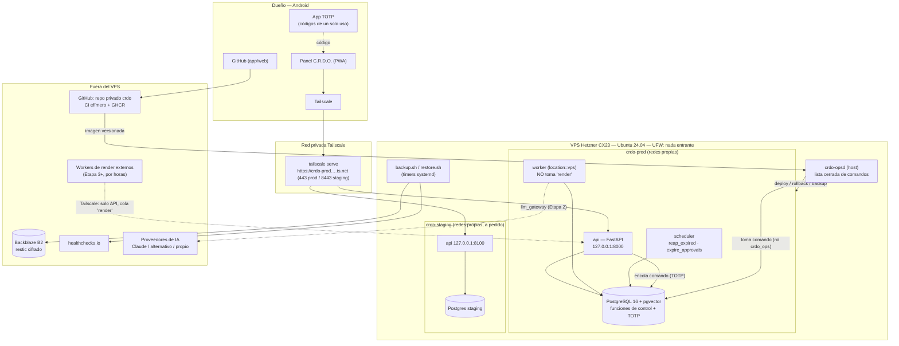
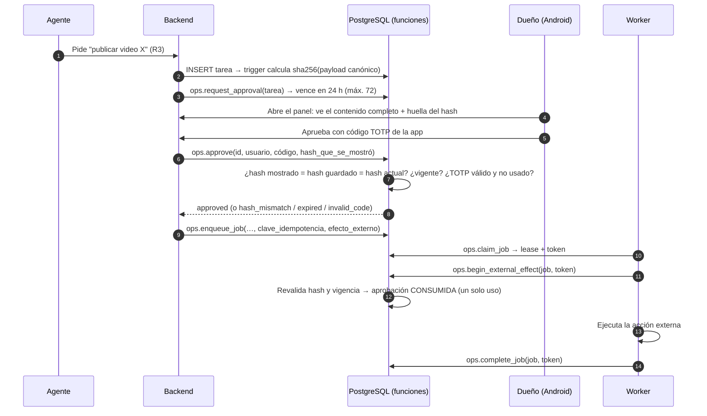
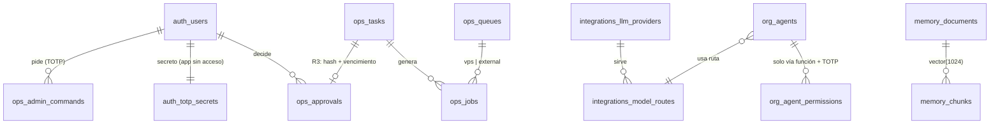

# C.R.D.O. — Etapa 1: Infraestructura central en la nube

> **Versión 2 — revisión técnica posterior a la aprobación de la arquitectura general.**
>
> **Estado: DISEÑO. No hay nada instalado, contratado ni conectado.** La aprobación de la arquitectura
> **no** autoriza gastos ni el inicio de la instalación (instrucción del dueño, 7 nov 2026).
>
> - Los archivos de `infra/` son configuración en borrador.
> - Lo que se ejecutó, se ejecutó en un contenedor temporal de diseño (Ubuntu 24.04), no en un servidor de
>   C.R.D.O. y sin tocar ninguna cuenta. El detalle de qué se probó y qué no está en §F.0.
> - Los cambios respecto de la v1 están en [`CAMBIOS-v2.md`](CAMBIOS-v2.md).
>
> Fecha: 7 de noviembre de 2026.

---

## Índice

- [Resumen ejecutivo](#resumen-ejecutivo)
- [FASE A — Requisitos y limitaciones](#fase-a--análisis-de-requisitos-y-limitaciones)
- [FASE B — Proveedores, tecnologías y costos](#fase-b--comparación-de-proveedores-y-tecnologías)
- [FASE C — Arquitectura](#fase-c--diseño-de-arquitectura-completa)
- [FASE D — Carpetas, servicios y base de datos](#fase-d--estructura-de-carpetas-servicios-y-base-de-datos)
- [FASE E — Instalación](#fase-e--plan-de-instalación-y-configuración)
- [FASE F — Pruebas y criterios de aceptación](#fase-f--plan-de-pruebas-y-criterios-de-aceptación)
- [FASE G — Informe técnico final](#fase-g--informe-técnico-final)
- [Preguntas abiertas](#preguntas-abiertas)

---

## Resumen ejecutivo

| Decisión | v2 |
|---|---|
| Servidor | **1 VPS Hetzner CX23** (2 vCPU / 4 GB), Ubuntu 24.04 LTS, Docker Compose. Se pasa a CX33 cuando haga falta, en minutos y sin reinstalar |
| Video pesado | **El VPS no renderiza.** Solo organiza el trabajo. El render va a workers externos por horas (Etapa 3+), forzado por la base de datos y por topes de CPU |
| Acceso desde Android | **Tailscale** (app oficial) + panel PWA publicado con `tailscale serve` (HTTPS, solo tus dispositivos). **Sin dominio ni Cloudflare en el núcleo** |
| Base de datos | **PostgreSQL 16 + pgvector**. pgvector quedó probado (§F.0) |
| Tareas | Cola en Postgres con **leases, token de exclusión, idempotencia y recolector**. Las acciones irreversibles nunca se repiten solas |
| Aprobaciones | Ligadas al **hash exacto** del contenido, con **vencimiento** (24 h, máximo 72 h), **TOTP de un solo uso verificado dentro de la base** y **consumo único** |
| Respaldos | restic (cifrado del lado del cliente) → Backblaze B2 + manifiesto + prueba de restauración semanal. **Verificados con los scripts reales** (§F.0) |
| Entornos | CI efímero (GitHub Actions) + staging aislado en el mismo VPS (proyecto, redes, base y secretos propios) + staging por horas opcional |
| Repositorio | **`crdo` privado e independiente**, con el historial exportado desde `Radar`. Script listo; el repositorio lo creás vos |
| IA | `llm_gateway` con **rutas de modelo** y proveedores intercambiables. Herramientas por MCP. Memoria e historial propios |
| **Costo fijo mínimo** | **≈ US$ 5–6/mes + impuestos** (antes: US$ 9–14). Todo lo demás se suma cuando haga falta (§B.4) |

---

## FASE A — Análisis de requisitos y limitaciones

### A.1 Requisitos funcionales

| # | Requisito | Cómo se cumple (v2) |
|---|---|---|
| RF1 | 24/7 sin el teléfono | VPS en la nube; el teléfono es solo cliente |
| RF2 | Toda la administración desde Android | Matriz completa en §C.8: panel + TOTP + Tailscale + apps web de los proveedores |
| RF3 | Preparado para Claude API, sin depender de Claude | `llm_gateway` con rutas y proveedores intercambiables (§C.9) |
| RF4 | Preparado para MCP | Servidor MCP propio + `mcp_gateway`, red interna, permisos por herramienta (`mcp/README.md`) |
| RF5 | Organización de 11 departamentos + Dirección | Tablas listas; contrato de agentes en `agents/README.md`; ningún agente construido |
| RF6 | Memoria empresarial | Postgres + pgvector (probado) + búsqueda de texto completo en español |
| RF7 | Integraciones futuras | Tablas de conexiones por referencia a secreto; **nada conectado** |
| RF8 | Autorización humana ligada al contenido | Hash + vencimiento + TOTP de un solo uso + consumo único (§C.4) |
| RF9 | Recuperación de tareas sin duplicados | Leases, token de exclusión, idempotencia, recolector, `needs_review` (§C.7) |
| RF10 | Respaldo cifrado y restauración verificada | restic + manifiesto + prueba semanal (§C.10) |
| RF11 | Pruebas aisladas de producción | Tres niveles de entorno (§C.5) |
| RF12 | Control de costos | Núcleo mínimo, servicios diferidos con disparador explícito (§B.4), presupuestos en la base |
| RF13 | Sin render en el VPS | Cola `render` marcada `external`; el worker del VPS no puede tomarla (§C.6) |

### A.2 Limitaciones y supuestos

| Limitación / supuesto | Consecuencia |
|---|---|
| Administración principalmente desde Android | Todo debe poder hacerse en el panel o en una app/web móvil. SSH solo para emergencias (Termux/Termius por Tailscale) |
| Android permite **una VPN a la vez** | Si usás otra VPN en el teléfono, hay que apagarla para entrar al panel. Se evalúa Cloudflare Access como alternativa (diferido) |
| Presupuesto bajo, sin ingresos | Un solo VPS chico. Staging comparte máquina, pero no comparte red, datos ni secretos |
| La suscripción de Claude no incluye la API | La API se paga aparte, por uso, desde Etapa 2, con tope duro en la consola de Anthropic |
| Precios del cloud cambiaron en 2026 | Todo precio está marcado "verificar" |
| Render de video necesita CPU/GPU fuerte | Fuera del VPS por diseño (§C.6) |

---

## FASE B — Comparación de proveedores y tecnologías

### B.1 Proveedores cloud

Sin cambios de fondo respecto de la v1. Precios de fuentes secundarias de noviembre 2026; **todos a verificar**
en la página oficial (Hetzner y Oracle cambiaron condiciones en abril y junio de 2026).

| Criterio | **Hetzner Cloud** (recomendado) | DigitalOcean | Oracle *Always Free* | Google Cloud |
|---|---|---|---|---|
| Referencia | CX23: 2 vCPU / 4 GB / 40 GB (≈ €4) · CX33: 4 vCPU / 8 GB (≈ €6,50) | 2 vCPU / 4 GB ≈ US$ 24 | ARM gratis (cupo reportado: 2 OCPU / 12 GB) | e2-medium ≈ US$ 25–35 |
| Precio fijo predecible | Sí | Sí | Gratis, pero con riesgo de recorte o borrado | No (por uso) |
| Cambio de tamaño | Minutos, sin reinstalar | Minutos | Limitado por capacidad | Minutos |
| Facturación por hora (útil para staging/render temporal) | Sí | Sí | — | Sí |
| Veredicto | **Núcleo** | Plan B | Solo pruebas | Más adelante, por cercanía a YouTube/Drive |

### B.2 Tecnologías (cambios v2 marcados ★)

| Pieza | Elegido | Motivo |
|---|---|---|
| SO | Ubuntu 24.04 LTS | LTS hasta 2029. Es el mismo sistema que el entorno donde se corrieron las pruebas |
| Contenedores | Docker + Compose v2 | Portable, suficiente para 1 servidor |
| ★ Publicación del panel | `tailscale serve` | HTTPS gratis en `*.ts.net`, sin dominio, sin puertos abiertos, solo tus dispositivos |
| ★ Proxy / borde público | Caddy + Cloudflare Tunnel/Access → **diferido** (`infra/optional/edge`) | Solo hace falta si se necesita acceso sin Tailscale o webhooks públicos |
| Backend | Python 3.12 + FastAPI | Coherente con JARVIS; SDKs oficiales de Anthropic, MCP y Google |
| Base de datos | PostgreSQL 16 + pgvector | Un motor para datos, cola, memoria y auditoría |
| ★ Lógica crítica | Funciones SQL `SECURITY DEFINER` | Aprobaciones, cola y permisos no dependen de que la app sea correcta: la base lo impone |
| Objetos | S3-compatible (R2) → **diferido** hasta que haya archivos | Sin uso real en Etapa 1 |
| Respaldos | restic → Backblaze B2 | Cifrado del lado del cliente, deduplicado, verificable |
| ★ CI / entorno efímero | GitHub Actions | Gratis en repos privados dentro del cupo (*verificar minutos*); máquina nueva en cada ejecución |
| Panel | PWA en HTML + JS sin framework | Liviana en Android, instalable |

### B.3 Claude, MCP e independencia de proveedor

Detalle en §C.9. En resumen: Claude es **un proveedor detrás de una puerta**, no una pieza de la arquitectura.

### B.4 Costos: indispensable vs. diferido

Importes estimados, **a verificar**. No incluyen impuestos argentinos a servicios digitales del exterior (*verificar con tu banco*).

**Nivel 0 — Indispensable para cerrar la Etapa 1**

| Servicio | Tipo | Estimado/mes | Por qué es indispensable |
|---|---|---|---|
| Hetzner CX23 | Fijo | ≈ €4 | El servidor 24/7 |
| IPv4 pública Hetzner | Fijo | ≈ €0,50–0,60 | Descargar imágenes de GHCR/GitHub, que no tienen IPv6 (*verificar*) |
| Tailscale Personal | Gratis | 0 | Acceso privado desde Android y publicación del panel |
| Backblaze B2 | Gratis hasta 10 GB | 0 | Respaldo fuera del proveedor. Sin esto la Etapa 1 no cumple "respaldada" |
| GitHub (repo privado, Actions, GHCR) | Gratis dentro del cupo | 0 | Código, CI e imágenes |
| healthchecks.io Hobby | Gratis | 0 | Aviso si falla un respaldo o se cae el servidor |
| **Total Nivel 0** | | **≈ €4,50–4,60 ≈ US$ 5–6** | |

**Nivel 1 — Recomendado pero diferible** (se activa cuando se cumple el disparador)

| Servicio | Estimado/mes | Disparador para activarlo |
|---|---|---|
| Backups automáticos de Hetzner (+20 %) | ≈ €0,80 | Cuando haya datos de negocio reales, como segunda capa además de restic |
| Subir a CX33 | +≈ €2,50 | RAM > 75 % sostenida o staging permanente |
| Dominio propio + Cloudflare (Tunnel/Access) | ≈ US$ 1 | Acceso sin Tailscale, webhooks públicos o redirección OAuth que Google no acepte en `ts.net` (*verificar en Etapa 2*) |
| Cloudflare R2 | 0 hasta 10 GB, luego por GB | Primer archivo de producción (guiones, miniaturas, audio) |
| Staging por horas (otro VPS) | Céntimos por sesión | Antes de cambios riesgosos (migraciones grandes, actualización de Postgres) |

**Nivel 2 — Variable, Etapa 2 en adelante**: Claude API u otro proveedor (por tokens, con tope), workers de
render por horas, Google One si se usa Drive. Todo con presupuesto en `finance.budgets` y corte automático.

> **Ahorro frente a la v1:** de ≈ US$ 9–14 a ≈ US$ 5–6 de costo fijo mínimo. Se difieren el dominio, Cloudflare,
> el CX33 y los backups de Hetzner, sin perder seguridad en el núcleo: Tailscale reemplaza a Cloudflare Access
> para un único usuario.

**Memoria en el CX23 (4 GB + 2 GB de swap):** los topes de producción suman ≈ 3,2 GB, pero son máximos, no
reservas. **Staging se levanta solo cuando se prueba** (`crdo deploy --env staging`) y se apaga después. Con un
CX33, staging puede quedar encendido.

---

## FASE C — Diseño de arquitectura completa

### C.1 Diagrama general



### C.2 Capas

| Capa | Componente | Quién la toca |
|---|---|---|
| Acceso | Tailscale (política en `infra/tailscale/policy.hujson`) | Dueño |
| Núcleo | `api`, `worker`, `scheduler` | Código revisado en el repo privado |
| Autoridad | Funciones SQL de `03-ops-functions.sql` | Solo por migración revisada |
| Datos | PostgreSQL | La app con `crdo_app` (permisos mínimos); nadie directo |
| Operación del host | `crdo-opsd` + `crdo` | Solo comandos de la lista, pedidos con TOTP |
| Resguardo | restic → B2 | Llave sin permiso de borrado desde el VPS |

### C.3 Organización preparada

Sin cambios: Dirección (rol, hoy Claude y luego un director propio) + 10 departamentos bajo Dirección.
**Auditoría reporta al dueño**, no a Dirección.

### C.4 Aprobaciones humanas ligadas al contenido exacto ★



| Garantía | Mecanismo | Probado (§F.0) |
|---|---|---|
| Se aprueba exactamente lo que se vio | El panel envía el hash que mostró; la base lo compara con el guardado y con el actual | ✅ |
| El contenido no cambia después | Columna `payload` sin permiso de UPDATE para la app + trigger que lo impide + nueva verificación del hash al ejecutar | ✅ (incluye alteración forzada por superusuario) |
| Vencimiento | 24 h por defecto, máximo 72 h (CHECK). Vencida = no se puede aprobar ni ejecutar | ✅ |
| Código de un solo uso | TOTP RFC 6238 verificado **dentro de PostgreSQL**. Cada código sirve una vez por usuario (`totp_last_step`). 5 fallos bloquean 15 min | ✅ (4 vectores oficiales del RFC) |
| La app no puede fabricar códigos | El secreto TOTP está en `auth.totp_secrets`, sin permiso de lectura para la app | ✅ |
| La app no puede autoaprobarse | Sin INSERT/UPDATE sobre `ops.approvals`; solo funciones | ✅ (en la v1 sí podía: corregido) |
| Una aprobación = una ejecución | Estado `consumed` al iniciar el efecto | ✅ |
| Rechazar o apagar agentes es fácil | Rechazar y apagar agentes no exigen código (es la dirección segura); aprobar y encender sí | ✅ |

**Limitación conocida:** si un atacante tiene a la vez tu teléfono desbloqueado (app TOTP) y acceso al panel, puede
aprobar. Mitigación: bloqueo de pantalla, app TOTP con PIN o biometría, y revocación del dispositivo en Tailscale.

### C.5 Entornos de prueba aislados ★

| Nivel | Dónde | Aislamiento | Costo | Uso |
|---|---|---|---|---|
| **1. CI efímero** | GitHub Actions (`.github/workflows/ci.yml`) | Máquina nueva por ejecución, **sin secretos**, se destruye | 0 (cupo, *verificar*) | Cada cambio: esquema, seguridad, cola, pgvector, respaldo/restauración, shellcheck, búsqueda de secretos |
| **2. Staging** | Mismo VPS, proyecto `crdo-staging` | Contenedores, **redes**, volumen, base, contraseñas, bucket y llaves propios; topes de CPU/RAM; agentes apagados; presupuesto de IA ínfimo; `CRDO_FORBID_PROD_CONNECTIONS=1` | 0 | Probar una versión antes de producción |
| **3. Staging por horas** (opcional) | VPS temporal en Hetzner | Máquina distinta | Céntimos por sesión | Cambios riesgosos: actualizar Postgres, migraciones grandes, ensayo de desastre (T13) |

Corrección v2: en la v1, prod y staging compartían la red `crdo_app` a través de Caddy. Ahora no comparten ninguna:
la configuración resuelta muestra solo redes `crdo-staging_*` (§F.0).

**Reglas que no se negocian:** staging nunca tiene credenciales del canal real ni de pagos, y nunca se restaura
producción en staging sin anonimizar.

### C.6 El VPS no renderiza video ★

| Capa | Mecanismo |
|---|---|
| Base de datos | `ops.queues`: `render` y `ai_media` tienen `runs_on = 'external'`. `ops.claim_job(…, 'vps')` **no los devuelve, ni pidiéndolos explícitamente** (probado) |
| Contenedor | Worker con `CRDO_WORKER_LOCATION=vps`, tope de 1 CPU y 768 MB; la imagen no incluye ffmpeg |
| Red | Los workers externos entran por Tailscale (`tag:crdo-worker`) y solo llegan a la API |
| Qué SÍ hace el VPS | Orquestar, guardar metadatos, llamar APIs, procesar texto, miniaturas livianas |
| Dónde irá el render (Etapa 3+, a decidir) | VPS de CPU dedicada por horas (crear → renderizar → destruir), GPU alquilada para IA generativa, o APIs de generación de video. Todos toman de la cola `render` y suben el resultado al almacenamiento de objetos |

### C.7 Recuperación de tareas interrumpidas y no duplicación ★

| Problema | Solución | Probado |
|---|---|---|
| Dos workers toman el mismo trabajo | `SELECT … FOR UPDATE SKIP LOCKED` | ✅ 6 workers, 300 trabajos: 300 tomas únicas, `attempts = 1` en todos |
| Se pide dos veces lo mismo | `idempotency_key` UNIQUE en tareas y trabajos | ✅ |
| El worker se cae a mitad de camino | **Lease** con vencimiento (5 min por defecto) + `heartbeat`; el `scheduler` ejecuta `ops.reap_expired()` cada minuto y reencola | ✅ |
| Un worker "zombi" vuelve y pisa al nuevo | **Token de exclusión** nuevo en cada toma; completar o fallar con un token viejo no tiene efecto | ✅ |
| Falla temporal | Reintento con espera exponencial (30 s, 60 s, 120 s… máx. 1 h) hasta `max_attempts`, luego `dead` | ✅ |
| **Caída después de iniciar una acción irreversible** (¿se publicó o no?) | `begin_external_effect` marca `effect_started_at` **antes** de actuar. Si el lease vence después, el trabajo queda en **`needs_review`** y **no se reintenta solo**: lo decide un humano. Las colas de efecto externo tienen 1 intento | ✅ |
| Detectar si la acción externa ya ocurrió | Etapa 2: cada integración guarda el id externo (p. ej. id de YouTube) y consulta antes de repetir | Diseño |

Regla: **las tareas internas son "al menos una vez" con idempotencia; las acciones externas irreversibles son "como
máximo una vez", con revisión humana ante la duda.**

### C.8 Administración completa desde Android ★

Requisitos en el teléfono: Tailscale, una app TOTP con respaldo cifrado (p. ej. Aegis), un gestor de contraseñas
(p. ej. Bitwarden), la app de GitHub y, para emergencias, Termux o Termius.

| Tarea | Cómo, desde Android | ¿Necesita PC? |
|---|---|---|
| Ver estado, salud, costos, cola, auditoría | Panel PWA (con Tailscale activo) | No |
| Aprobar o rechazar publicaciones y gastos | Panel + código TOTP | No |
| Apagar todos los agentes | Botón del panel (sin código) | No |
| Encender agentes / otorgar permisos | Panel + TOTP | No |
| Respaldo inmediato / prueba de restauración | Panel → comando admin con TOTP → `crdo-opsd` | No |
| Desplegar versión / rollback / reiniciar servicio | Panel → comando admin con TOTP → `crdo-opsd` (con respaldo automático previo) | No |
| Revisar y aprobar cambios de código | App de GitHub: PR + CI verde → merge | No |
| Publicar una versión | GitHub web: *Releases → New release* (tag `x.y.z`) → Actions construye la imagen | No |
| Política de acceso Tailscale / revocar un dispositivo | Consola web de Tailscale | No |
| Cambiar o rotar un secreto | SSH por Tailscale (Termux/Termius) + `nano /opt/crdo/secrets/prod.env` + reinicio | No (incómodo) |
| Servidor sin respuesta | Consola web de Hetzner: reiniciar, consola de emergencia, modo rescate (*verificar usabilidad en móvil*) | No |
| Reconstruir desde cero (desastre) | Runbook por SSH desde Termux: crear VPS → `bootstrap-server.sh` → restaurar | No, pero en PC es más cómodo. Se ensayará (T13) |
| Alertas | healthchecks.io → email o Telegram | No |
| **Teléfono perdido** | Códigos de recuperación en papel → otro dispositivo → revocar el teléfono en Tailscale → cerrar sesiones del panel → re-enrolar TOTP | Otro dispositivo cualquiera |

**Por qué no hay socket de Docker en los contenedores:** si el panel pudiera ejecutar Docker, quien comprometiera el
panel controlaría el servidor. En su lugar, el panel **encola** un comando (exige TOTP, lo verifica la base) y
`crdo-opsd`, en el host, ejecuta solo comandos de una lista cerrada con argumentos validados.

### C.9 Claude API, MCP y agentes sin depender de Claude ★

| Riesgo de dependencia | Diseño |
|---|---|
| Código atado a la API de un proveedor | `llm_gateway` con adaptadores (`anthropic_messages`, `openai_chat`). Agentes y backend llaman a **rutas** (`razonamiento`, `redaccion`, `clasificacion`, `embeddings`) definidas en `integrations.model_routes`, con proveedor principal y alternativas |
| Instrucciones escritas para un modelo | Instrucciones de agentes versionadas en el repo propio (`agents/`), neutrales, con evaluaciones para comparar proveedores |
| Herramientas propietarias | Herramientas expuestas por **MCP** (estándar abierto) desde un servidor propio (`crdo-mcp`) |
| Memoria dentro del proveedor | Memoria en Postgres propio. Cada embedding registra su modelo (`embed_model`) y puede recalcularse con otro |
| Historial perdido | Toda llamada guarda entrada, salida, costo y tarea. Sirve para auditar, migrar o entrenar un modelo propio |
| Claude como administrador | Claude ocupa el **rol** Dirección, sin credenciales, sin R4, con R3 sujeto a aprobación; Auditoría no le reporta |
| Caída o cambio de condiciones del proveedor | Ruta con alternativa; kill switch; presupuesto con corte automático |

En la Etapa 1, los gateways quedan **apagados** (`llm_gateway_enabled = false`, llaves vacías) y no se conecta ningún proveedor.

### C.10 Cifrado, respaldo y restauración ★

| Aspecto | Diseño | Verificado (§F.0) |
|---|---|---|
| Cifrado en tránsito | Tailscale (WireGuard) para administración; HTTPS de `tailscale serve`; TLS hacia B2 | Diseño |
| Cifrado del respaldo | restic: AES-256 + autenticación, **antes** de salir del VPS. B2 nunca ve datos en claro | ✅ marcador confidencial y SQL ausentes del repositorio; contraseña incorrecta no abre |
| Integridad | `restic check --read-data` | ✅ detecta una corrupción de 4 bytes |
| Volcado verificado antes de subir | `pg_restore --list` + manifiesto (conteos + último hash de auditoría) | ✅ |
| Sin restos en claro | El volcado temporal se borra al subir | ✅ |
| Secretos fuera de los respaldos de configuración | `--exclude '*.env'` | ✅ |
| Fallo visible | Fallo de `pg_dump` → error + `healthchecks /fail`, sin snapshot incompleto | ✅ |
| Restauración probada | `restore.sh test`: restaura en una base temporal, compara con el manifiesto y verifica la cadena de auditoría | ✅ (2 s con datos pequeños) |
| Detecta manipulación | Un evento de auditoría alterado antes del respaldo hace **fallar** la prueba de restauración | ✅ |
| No se puede borrar desde el VPS | Llave de B2 sin `deleteFiles`; limpieza mensual con otra llave que solo tiene el dueño | Pendiente: requiere cuenta B2 (T14) |
| Contraseña de restic | En el gestor de contraseñas **y** en papel. Sin ella los respaldos son irrecuperables | Procedimiento |
| Cifrado en reposo del disco del VPS | No se agrega cifrado de disco: protege poco en un VPS con arranque desatendido. Los secretos están en archivos 600 y los respaldos van cifrados | Decisión documentada |

---

## FASE D — Estructura de carpetas, servicios y base de datos

### D.1 Repositorio privado `crdo` ★

Hoy vive en `Radar/crdo/`. `tools/export-to-private-repo.sh` lo exporta con su historial a un repositorio privado
vacío que creás vos (§E.1). Tras la exportación, esta carpeta es la raíz:

```
crdo/
├── README.md
├── .gitignore                    ← bloquea *.env, secretos, volcados
├── .github/workflows/ci.yml      ← CI efímero (se activa en el repo propio)
├── docs/
│   ├── ETAPA-1-DISENO.md         ← este documento
│   ├── CAMBIOS-v2.md             ← informe de cambios v1 → v2
│   └── runbooks/                 ← [implementación] restaurar, rotar llaves, desastre, teléfono perdido
├── infra/
│   ├── compose.yml               ← núcleo (api, worker, scheduler, postgres)
│   ├── compose.staging.yml       ← staging aislado
│   ├── .env.example
│   ├── db/init/
│   │   ├── 00-roles.sh           ← roles con login (contraseñas por entorno)
│   │   ├── 01-core.sql           ← esquema + permisos mínimos
│   │   ├── 02-memory-vector.sql  ← pgvector (HNSW + texto completo)
│   │   └── 03-ops-functions.sql  ← TOTP, aprobaciones, cola, comandos admin, auditoría
│   ├── scripts/
│   │   ├── bootstrap-server.sh   ← endurecimiento del VPS
│   │   ├── backup.sh / restore.sh
│   │   ├── crdo                  ← deploy / rollback / status
│   │   └── crdo-opsd             ← ejecutor de comandos del panel (host)
│   ├── systemd/                  ← timers de respaldo y prueba, servicio crdo-opsd
│   ├── tailscale/policy.hujson   ← quién llega a qué
│   └── optional/edge/            ← Caddy + Cloudflare (diferido)
├── tests/
│   ├── run-db-tests.sh           ← 83 verificaciones
│   ├── run-backup-tests.sh       ← 18 verificaciones
│   └── db/*.sql
├── tools/export-to-private-repo.sh
├── agents/README.md              ← contrato de agentes (ninguno construido)
├── mcp/README.md                 ← reglas MCP (nada conectado)
├── backend/                      ← [implementación] FastAPI
└── panel/                        ← [implementación] PWA
```

### D.2 Servidor

```
/opt/crdo/
├── app/          ← clon del repo privado (llave de despliegue de solo lectura)
├── secrets/      ← root 700: prod.env, staging.env, restic.env (600)
├── data/{prod,staging}/postgres/
├── backups/      ← temporales; se borran al subir
├── releases/     ← historial de versiones (para rollback)
└── logs/
```

### D.3 Servicios

| Servicio | Dónde | Expuesto | Tope (prod) |
|---|---|---|---|
| `api` | Contenedor | 127.0.0.1:8000 (staging 8100) → `tailscale serve` | 768 MB / 1,5 CPU |
| `worker` | Contenedor | — | 768 MB / 1 CPU |
| `scheduler` | Contenedor | — | 192 MB / 0,25 CPU |
| `postgres` | Contenedor, red interna | — | 1,5 GB / 1,5 CPU |
| `crdo-opsd` | Host (systemd) | — | — |
| Timers de respaldo y prueba | Host (systemd) | — | — |

### D.4 Base de datos (cambios v2)



| Tabla nueva o cambiada | Propósito |
|---|---|
| `auth.totp_secrets` ★ | Secreto TOTP; la app no puede leerlo |
| `auth.users` (cambiada) | `totp_last_step` (antirrepetición), contador de fallos, bloqueo |
| `ops.tasks` (cambiada) | `payload_hash` (por trigger), `idempotency_key`, contenido inmutable |
| `ops.approvals` (rehecha) | Hash, vencimiento (máx. 72 h), paso TOTP usado, estado `consumed` |
| `ops.queues` ★ | Dónde corre cada cola (`vps` / `external`), lease e intentos |
| `ops.jobs` (rehecha) | Lease, token de exclusión, heartbeat, `effect_started_at`, `needs_review` |
| `ops.admin_commands` ★ | Comandos del panel para `crdo-opsd` |
| `integrations.llm_providers`, `model_routes` ★ | Independencia de proveedor de IA |
| `org.agents` (cambiada) | `default_route` en lugar de proveedor/modelo fijo |

Roles: `crdo_owner` (solo migraciones), `crdo_app`, `crdo_readonly`, `crdo_backup` y `crdo_ops` ★ (solo comandos admin).

---

## FASE E — Plan de instalación y configuración

**Nada de esto se ejecuta sin una autorización explícita de gasto e instalación.** 🔑 = lo hacés vos.

### E.0 Preparación (sin gasto)
1. 🔑 Correo exclusivo de C.R.D.O.; 2FA con app TOTP en correo, GitHub, Hetzner, Backblaze y Tailscale; códigos de
   recuperación **en papel**.
2. 🔑 En Android: Tailscale, Aegis (u otra app TOTP con respaldo cifrado), Bitwarden, GitHub, Termux o Termius.

### E.1 Repositorio privado (sin gasto)
3. 🔑 Crear en GitHub el repo **privado y vacío** `crdo`.
4. Exportar: `bash crdo/tools/export-to-private-repo.sh <url>` (lo puedo hacer yo con tu autorización; no crea
   nada en GitHub).
5. 🔑 Proteger `main`, activar *secret scanning* y Dependabot. Verificar que el CI pase en GitHub.

### E.2 Cuentas gratuitas
6. 🔑 Tailscale: cuenta, teléfono unido, pegar `infra/tailscale/policy.hujson`, *auth key* de un solo uso etiquetada `tag:crdo-server`.
7. 🔑 Backblaze B2: bucket privado `crdo-backups` (*Object Lock* si está disponible) + llave **sin permiso de borrado**.
8. 🔑 healthchecks.io: chequeos `backup-prod`, `restore-test`, `heartbeat`.

### E.3 Servidor (primer gasto, requiere autorización)
9. 🔑 Hetzner: proyecto `crdo`, CX23 Ubuntu 24.04, IPv4, firewall de Hetzner con SSH temporal solo desde tu IP.
10. `bootstrap-server.sh`: actualizaciones automáticas, usuario sin root, SSH solo por Tailscale, UFW, Docker, restic, estructura.
11. 🔑 Quitar la regla SSH temporal del firewall de Hetzner.

### E.4 Plataforma
12. Clonar el repo privado en `/opt/crdo/app` y crear `prod.env` y `staging.env` con contraseñas distintas.
13. `crdo deploy x.y.z` (prod), `tailscale serve` (443 → 8000, 8443 → 8100).
14. Crear usuario dueño y enrolar TOTP (CLI por SSH; muestra el QR una sola vez).
15. Activar `crdo-backup.timer`, `crdo-restore-test.timer` y `crdo-opsd.service`.
16. Desde Android: abrir el panel, instalarlo como app y ejecutar las pruebas de §F.1.

---

## FASE F — Plan de pruebas y criterios de aceptación

### F.0 Qué se verificó en esta revisión (honestidad)

Entorno: contenedor temporal de diseño con **Ubuntu 24.04**. Paquetes instalados solo ahí: `postgresql-16-pgvector
0.6.0` y `restic 0.16.4`. No es un servidor de C.R.D.O. y se destruye al terminar la sesión.

| Prueba | Resultado |
|---|---|
| `tests/run-db-tests.sh`: esquema completo (00–03) en PostgreSQL 16 | ✅ carga sin errores |
| Seguridad: permisos mínimos, auditoría append-only, R4, TOTP con 4 vectores oficiales RFC 6238, cadena de auditoría independiente de la zona horaria, bloqueo por fuerza bruta | ✅ 24/24 |
| Aprobaciones: hash, vencimiento, TOTP de un solo uso, consumo único, alteración forzada detectada | ✅ 23/23 |
| Cola: render solo externo, kill switch, lease vencido → reencolado, token viejo rechazado, `needs_review`, reintentos, comandos admin | ✅ 25/25 |
| **pgvector en PostgreSQL 16**: 2.000 vectores de 1024 dimensiones, dimensión incorrecta rechazada, índice HNSW usado por el planificador, recall@10 = **1,000** frente a búsqueda exacta (20 consultas), texto completo en español | ✅ 8/8 |
| Concurrencia: 6 workers simultáneos, 300 trabajos | ✅ cada trabajo tomado una sola vez; reparto 48/48/47/47/55/55 |
| **Total base de datos** | ✅ **83 verificaciones, 0 fallas** |
| `tests/run-backup-tests.sh` con `backup.sh` y `restore.sh` reales y restic real (repositorio local en lugar de B2) | ✅ **18 verificaciones, 0 fallas** |
| `docker compose config` prod y staging | ✅ válido; staging solo con redes `crdo-staging_*` |
| `bash -n` en todos los scripts | ✅ sintaxis válida (shellcheck no estaba disponible: lo corre el CI) |
| Búsqueda de secretos en el repo | ✅ ninguno |
| Exportación al repo privado (`export-to-private-repo.sh`) contra un repositorio local de prueba | ✅ ver `CAMBIOS-v2.md` |

**Errores reales que encontraron estas pruebas y la revisión** (corregidos; detalle en `CAMBIOS-v2.md`):
- La v1 dejaba a la app sin acceso a pgvector.
- La app podía autoaprobarse.
- Staging compartía una red con producción.
- El hash de auditoría dependía de la zona horaria.
- Un `REVOKE` de columnas no tenía efecto.

**Límites de lo probado:**
- El recall de 1,000 es con 2.000 vectores aleatorios; con millones de vectores reales hay que volver a medirlo.
- La versión de pgvector del VPS será la de la imagen Docker fijada, distinta de la 0.6.0 usada acá.
- Los 2 s de restauración son con una base mínima.

**No verificado (no hay servidor ni Docker en ejecución):**
- Contenedores corriendo y `00-roles.sh` dentro del *entrypoint* de la imagen.
- `tailscale serve` y la política de Tailscale.
- `crdo deploy` y `crdo rollback`, `crdo-opsd`, `bootstrap-server.sh`, los timers de systemd y la rama Docker de `restore.sh`.
- La llave de B2 sin borrado, los avisos a healthchecks y el CI corriendo en GitHub.
- Que la conexión local por socket de la imagen de Postgres use `trust`, que es lo que `crdo-opsd` supone.

### F.1 Pruebas de aceptación tras instalar (sin cambios de fondo, ampliadas)

| ID | Prueba | Criterio |
|---|---|---|
| T01 | Teléfono apagado 24 h | Heartbeat sin cortes |
| T02 | Panel desde Android con datos móviles + Tailscale | Carga < 3 s; estado, recursos, último respaldo |
| T03 | `nmap` a la IP pública | **0 puertos abiertos** |
| T04 | Panel desde un dispositivo fuera de la red Tailscale | Inaccesible |
| T05 | Login: sin TOTP, TOTP repetido, 5 fallos | Rechazos + bloqueo + auditoría |
| T06 | SSH por IP pública / Tailscale con llave / con contraseña | No / sí / no |
| T07 | Secretos en el repo y permisos de `/opt/crdo/secrets` | 0 secretos; 600 root |
| T08 | Las 83 pruebas de base de datos **contra el Postgres del VPS** (en una base de prueba) | 0 fallas |
| T09 | Aprobación R3 de punta a punta desde el teléfono | Hash visible; TOTP; consumo único |
| T10 | Solicitud R4 de un agente | Rechazo inmediato |
| T11 | Presupuesto de prueba superado | Corte + alerta |
| T12 | Respaldo manual desde el panel (comando admin) | Snapshot en B2 + manifiesto + healthchecks |
| T13 | **Desastre**: VPS nuevo desde cero + restauración, desde el teléfono | RTO < 2 h, RPO ≤ 24 h |
| T14 | Borrar snapshots de B2 desde el VPS | Rechazado |
| T15 | Desde staging, alcanzar la base de producción | Imposible |
| T16 | Deploy en staging y prod desde el panel; forzar fallo de `/health` | Respaldo previo + rollback automático |
| T17 | Error 500 provocado | Visible en el panel con id de correlación |
| T18 | Carga leve + alertas de disco | Sin errores; alertas funcionan |
| T19 | (Opcional) restaurar en otro proveedor | Funciona sin cambios de código |
| T20 | Gateways con llaves vacías | Responden "deshabilitado" |
| T21 ★ | Matar el worker en medio de un trabajo | Lo retoma otro tras vencer el lease; sin duplicado |
| T22 ★ | Encolar un trabajo `render` en el VPS | El worker del VPS no lo toma |
| T23 ★ | Cada fila de la matriz Android (§C.8) | Realizable sin PC |
| T24 ★ | CI en el repo privado | Verde en GitHub |

**Criterio de finalización:** T01–T18 y T20–T24 aprobadas con evidencia en `docs/runbooks/acta-pruebas-etapa1.md`.

---

## FASE G — Informe técnico final

### G.1 Entregables

| # | Entregable | Dónde |
|---|---|---|
| 1 | Diagramas | §C.1, §C.4, §D.4 |
| 2 | Tecnologías | §B.2 |
| 3 | Proveedores | §B.1 |
| 4 | Presupuesto por niveles | §B.4 |
| 5 | Carpetas | §D.1, §D.2 |
| 6 | Base de datos | §D.4 + `infra/db/init/` |
| 7 | Seguridad | §C.4, §C.5, §C.8, §C.10, §G.2 |
| 8 | Instalación | §E |
| 9 | Configuración inicial | `infra/`, `.github/`, `tools/` |
| 10 | Pruebas | §F + `tests/` (ejecutables) |
| 11 | Requisitos Etapa 2 | §G.5 |

### G.2 Seguridad (resumen)

| Control | Implementación |
|---|---|
| Acceso | Tailscale (solo tus dispositivos) + login + TOTP. SSH solo por Tailscale con llave |
| Secretos | `/opt/crdo/secrets` (600), `.gitignore`, escaneo en CI, excluidos de los respaldos de configuración |
| Permisos mínimos | 5 roles de base. La app no puede tocar aprobaciones, permisos, trabajos, secretos TOTP ni el kill switch salvo por funciones |
| Autorización humana | R3: hash + vencimiento + TOTP de un solo uso + consumo único. R4: imposible para agentes |
| Registro | Auditoría append-only con cadena de hash verificable, también al restaurar |
| Respaldos | Cifrados, verificados, prueba de restauración semanal, llave sin borrado |
| Entornos | CI efímero, staging aislado, staging por horas opcional |
| Operaciones del servidor | Sin socket de Docker en contenedores; `crdo-opsd` con lista cerrada |

### G.3 Dependencias

Tailscale, Backblaze, GitHub y healthchecks (gratis); Hetzner (pago); imágenes `pgvector/pgvector` y `python` con versión fija.

### G.4 Riesgos (actualizados)

| ID | Riesgo | Mitigación |
|---|---|---|
| R1 | Falla del VPS | Respaldos fuera del proveedor + T13 ensayado |
| R2 | Cambios de precio | Portabilidad; núcleo mínimo |
| R3 | Filtración de llaves | Secretos fuera del repo, escaneo, topes por proveedor |
| R4 | Staging afecta a prod (misma máquina) | Topes de CPU/RAM; staging a pedido; staging por horas para lo riesgoso |
| R5 | Pérdida del teléfono | Códigos en papel, revocación en Tailscale, re-enrolamiento |
| R6 ★ | Dependencia de Tailscale para entrar | Alternativas: consola de Hetzner (emergencia) y borde Cloudflare (diferido, listo en `optional/edge`) |
| R7 ★ | Android, una VPN a la vez | Documentado; Cloudflare Access como alternativa futura |
| R8 | Agente fuera de permisos | Autoridad en la base, no en la app; kill switch |
| R9 | Costos de IA | Tope en consola + presupuestos internos con corte |
| R10 | Términos de servicio de YouTube | Publicación siempre con aprobación humana |
| R11 ★ | OAuth de Google y dominio `ts.net` | Verificar en Etapa 2; si no se acepta, activar dominio (Nivel 1) |
| R12 ★ | Tokens OAuth de apps no verificadas que vencen (modo prueba de Google) | Verificar la política vigente en Etapa 2 |
| R13 ★ | El secreto TOTP viaja en los respaldos (cifrados) | Quien tenga la contraseña de restic tiene también los secretos TOTP: guardarla con el mismo cuidado |

### G.5 Requisitos para comenzar la Etapa 2

1. Etapa 1 cerrada según §F.1.
2. Cuenta de organización en Anthropic con **tope de gasto** y llaves separadas para prod y staging. Opcional: un
   proveedor alternativo configurado para la ruta de respaldo.
3. Proyecto de Google Cloud de la empresa (YouTube Data y Analytics API, pantalla de consentimiento OAuth) y
   decisión sobre qué canal conectar, con tu autorización explícita.
4. Decisión sobre el dominio (R11) y sobre R2 vs. Drive.
5. Primer departamento, sugerido de solo lectura: Investigación + Analítica.
6. Presupuesto mensual por departamento.
7. Política editorial y de marca.
8. Revisión de los términos de servicio de YouTube y de la política de uso de Anthropic.

---

## Preguntas abiertas

Siguen pendientes de la v1, con la recomendación actual:

| # | Pregunta | Recomendación v2 |
|---|---|---|
| Q1 | ¿Dominio propio? | **Ya no hace falta en Etapa 1** (Tailscale). Decidir en Etapa 2 |
| Q2 | ¿Europa o EE. UU.? | Europa (más barato); la latencia del panel es aceptable |
| Q3 | ¿Presupuesto máximo mensual? | Núcleo ≈ US$ 5–6; definir tope para IA antes de Etapa 2 |
| Q4 | ¿Hetzner? | Sí; DigitalOcean como plan B |
| Q5 | ¿Staging separado? | Mismo VPS, a pedido; staging por horas para lo riesgoso |
| Q6 | ¿Cuenta de Google exclusiva? | Sí |
| Q7 | ¿Repo propio? | **Sí — preparado** (§E.1). Necesito que crees el repositorio privado vacío y me autorices a exportar |
| Q8 | ¿Tenés PC? | Ya no es requisito (§C.8); facilita solo el ensayo de desastre |
| Q9 ★ | ¿Usás otra VPN en el teléfono? | Si es así, conviene adelantar el borde Cloudflare (R7) |

*Fin del diseño v2. La arquitectura está aprobada; la instalación y los gastos siguen sin autorizar.*
